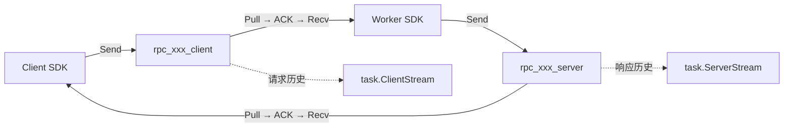
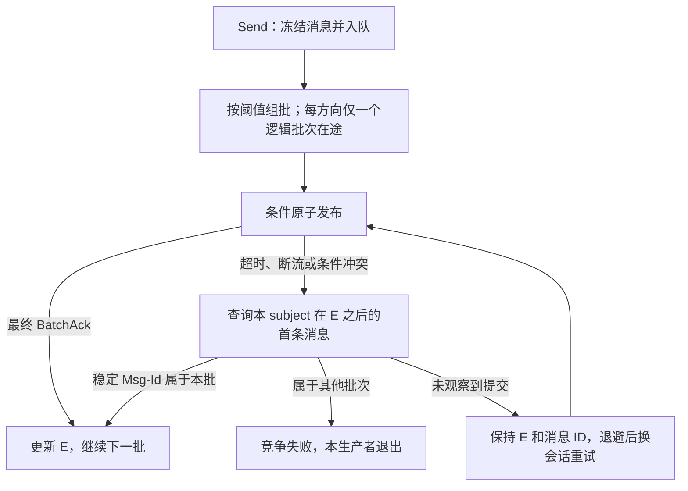
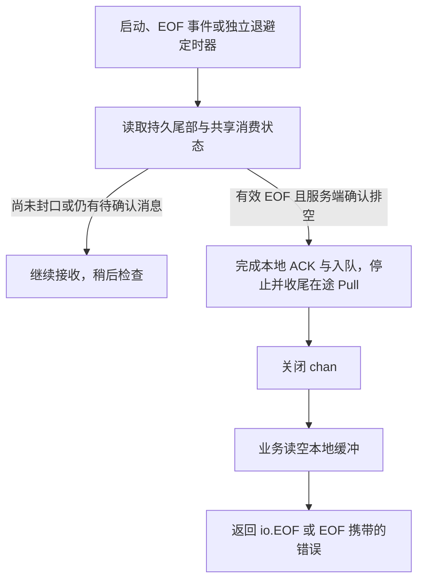

# RPC 流与历史读取设计

2026-10-15 · 目标：wego SDK 0.5.0 / 协议 7 · SDK 待实现；Extra 的能力与验收状态见实施参考。

**每次 RPC 使用两条独立的持久队列。生产者串行批量提交，消费者按本地容量拉取；恢复沿用发布尾部与消费进度，历史读取独立进行。**

## 1 总体方案与关键决策

两个 subject 都由 Extra 代理访问 NATS JetStream。它们共享 CallID，各自拥有发送队列、消费进度和 EOF；一个方向关闭，另一个仍可继续。

| 决策 | 原因与代价 |
| --- | --- |
| LimitsPolicy 按保留期保存消息 | ACK 后仍能回放；消费不会释放历史存储，必须限制容量 |
| Send 成功只表示进入本地 FIFO | 支持异步组批；崩溃可能丢失尚未提交的消息 |
| 串行原子批次 + 尾序号条件发布 | 保持入队顺序，竞争失败者退出；不保证新实例优先获胜 |
| 共享稳定 Pull consumer，ACK 后入 chan | 避免等待业务处理造成 ACK 超时；已 ACK 的内存消息可能在重启后丢失 |
| EOF + 消费进度判定结束 | 未收到 EOF 的实例也能退出；需要独立状态检查 |
| 历史采用固定快照、懒加载 | 不影响正常消费或发布基线；完整性受保留期约束 |

**交付边界：保证的是 SDK 接收，不是业务处理成功。** 新旧消费者可分担消息，也可能遇到重投；业务负责幂等、输入恢复和副作用，不承诺跨实例 Recv 顺序。

## 2 生产：有序提交，竞争退出

启动或恢复先读本方向的持久尾部：读到 EOF 就停止生产；否则记录实际尾序号 E。每次批量提交只在首条消息设置 `Nats-Expected-Last-Subject-Sequence=E`。

原子批次仍然是 N 条独立消息。未知结果核对使用稳定 Msg-Id；每次网络尝试使用新的 batch_id，不能把失败后读到的新尾部作为重新加入竞争的依据。

- 默认不额外等待组批；已有批次在途时继续积累。可配置条数、字节和最大等待时间。
- 暂时性失败重试；永久错误由后续 Send、CloseSend 或最终接收暴露，无法撤回此前的 Send 成功。
- **CloseSend：停止接纳 → 排空 FIFO → 提交最终 EOF → 等待发布确认。** 它不等待对端消费或业务处理。

## 3 消费：按空位拉取，独立判断结束

默认单次最多拉 100 条，本地缓冲 200 条，AckWait 为 60 秒；消息保留期单独配置。消息到达即可进入 ACK/交付流程，不等待整批 Fetch 结束；chan 满时不再新增 Pull。普通 ACK 成功只表示已发出，最终进度以服务端状态为准。

服务端排空要求 ACK floor 到达 EOF，且 NumPending、NumAckPending 均为 0。独立定时器不受满 chan 阻塞，所以没有拿到 EOF 的旧/新实例也能结束。

**恢复边界：** consumer 缺失、历史过期或运行最终失败都返回错误；不能当成功 EOF。方向 consumer 保留到恢复截止时间；全局 ACK 排空不表示其他实例的业务已经处理完。

## 4 RPC 与历史接口

| RPC 形态 | 请求方向 | 响应方向 |
| --- | --- | --- |
| Client stream | 多条请求，CloseSend 封口 | 成功时一条响应；CloseAndRecv 等最终状态 |
| Server stream | 一条请求并封口 | 多条响应；handler 返回后框架封口 |
| Bidi stream | 独立发送并半关闭 | 同时接收，独立封口 |

业务继续使用标准 gRPC 生成桩。最终成功/业务错误由 server EOF 表达；可重试执行失败不写最终 EOF，运行观察器负责唤醒最终失败或取消的调用。单请求/响应若已 ACK 后丢失，返回不可用错误，不自动从历史补交。

历史入口固定为 `task.ClientStream(ctx)` 和 `task.ServerStream(ctx)`，均返回 `model.StreamHistory`；无论调用者在哪一端，分别读取请求和响应历史。

- 创建句柄固定快照上界 H0；`Iterator`、`AllMessage`、`FirstMessage`、`LastMessage` 均只看该快照。
- `Contains` 按字段建立有界精确索引并复用，避免每次查询重扫；`Bloom` 用于预筛，命中仍须精确核对。
- 历史通过独立 Read 分页，`Close` 释放句柄资源；读历史不推进消费位置、不刷新生产者 E，也不是 Flush。

公开配置入口为 `runtime.WithStream(runtime.StreamConfig{...})`，按 Send、Recv、History 组织；业务接口不包含 NATS 资源与 consumer 参数。

## 5 实施顺序与关键约束

| 阶段 | 交付物 | 完成标准 |
| --- | --- | --- |
| 1. 固定传输能力（P0–P1） | 原子发布、批量 ACK、有限 Read、限额与错误分类 | 真实服务验证原子性、未知结果核对、分页与资源清理 |
| 2. 实现双向收发（P2） | FIFO、条件竞争、按容量 Pull、EOF 检查 | 并发、崩溃、满缓冲及未收到 EOF 的实例都能正确收尾 |
| 3. 接入 RPC 与历史（P3–P4） | 三种生成桩适配、运行观察器、快照与索引 | 关闭/取消/重试语义明确；历史不干扰正常流 |
| 4. 验收与替换（P5） | 配额、回收、诊断、压测和独立模块发布 | 故障验收通过，容量满足部署目标，清理被替换的路径 |

三项实施前必须守住的约束：

1. **容量按留存调用量计算。** 每次调用有两个方向 consumer，ACK 不释放历史。单方向配额预留 EOF；部署容量、调用准入与恢复期限必须一起确定。
2. **当前 Extra 是单节点。** 使用 R1 文件持久化；不能通过把配置改成 R3 就宣称获得集群容错。
3. **业务重试需要可恢复状态。** 未持久发布的输出、已 ACK 的输入和业务副作用不是一个事务；读输出历史不能自动恢复丢失的输入。

本方案替换输入收齐后才提交任务、CLAIM/epoch 接管、业务 Recv 后提交游标和 Checkpoint 读完才能发布等 RPC 流路径。普通 unary、任务事件及其他调用者仍使用的公共设施保留独立职责。

## 按需查阅

| 需要了解 | 文档 |
| --- | --- |
| 精确的发布、恢复、错误和结束判据 | [协议参考](nats-rpc-stream-protocol-reference.md) |
| 完整 StreamHistory 接口与使用示例 | [API 与示例](nats-rpc-stream-api-reference.md) |
| 配置默认值、容量校验、指标与诊断 | [配置与运维参考](nats-rpc-stream-config-reference.md) |
| 实施证据、详细步骤和测试矩阵 | [实施与验收参考](nats-rpc-stream-implementation-reference.md) |

评审依据见 [Claude 原评审](nats-rpc-stream-design-review.md)与[处理记录](nats-rpc-stream-design-review-resolution.md)。原章节编号保留在专题参考中；本文负责呈现关键决策，参考文档补充精确合同。
