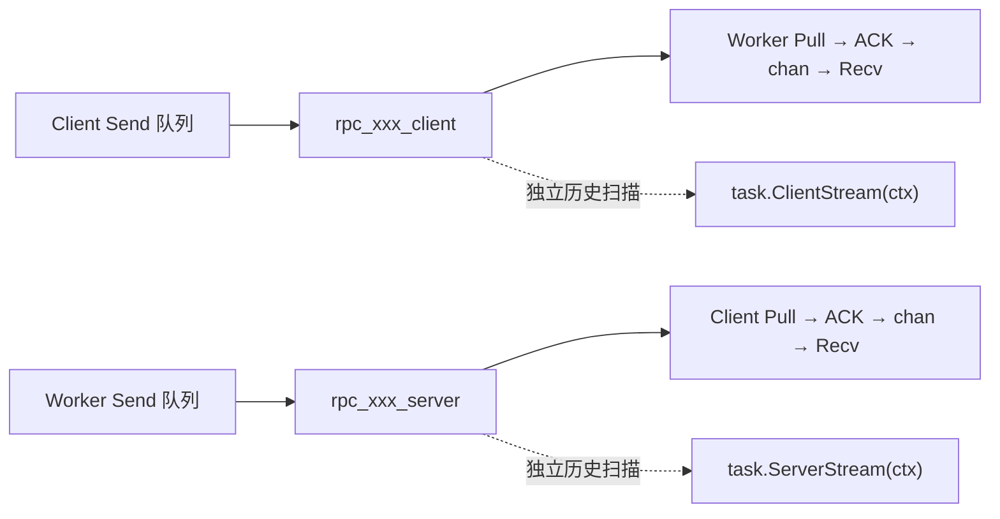

# RPC 流协议参考

先读 [主方案](nats-rpc-stream-design.md)。本文按需查阅：建立、收发、恢复与结束条件的实现细节。原章节编号保留，便于定位已有评审引用。

<a id="s1"></a>

## 1 背景与交付边界

需要同时满足：消息持久保留以支持回放；Send 支持本地缓冲和批量发布；进程重启后从持久状态继续；旧实例与恢复实例短暂并存；生产最终封口后，所有消费实例都能结束。

采用以下合同：

| 时点 | 含义 |
| --- | --- |
| Send 返回 nil | SDK 已接纳独立消息快照，可能仍在生产者内存中 |
| PublishBatch 收到最终 BatchAck | 当前批次全部持久提交到 NATS |
| Extra 返回普通 ACK 成功 | ACK 已发出，尚不证明 NATS 已确认消费进度 |
| 消费 ACK 在服务端生效 | SDK 已收到消息；消息可能尚未进入本地 chan |
| Recv 返回 DATA | 调用方已取到消息，业务处理由调用方负责 |
| CloseSend 成功 | 本方向此前接纳的消息和最终 EOF 已持久提交 |
| Recv 返回 io.EOF | 本方向已正常结束，本实例接收缓冲已读空 |

生产者未提交缓冲、消费者已 ACK 但未被 Recv 取出的缓冲，均不持久化。进程崩溃可以丢失这些消息；消费 ACK 丢失或超时又可能产生重复。业务需要自行保证副作用、幂等和业务恢复，不能把这个协议解释成业务端的恰好一次交付。

本次范围覆盖任务路径中的 client stream、server stream、bidi stream。普通 unary、DAG、Batch、网络 gRPC、通用 KV、task.StreamEvent 和 WorkerEvent 的产品契约独立存在。流历史读取不等于 Hatchet durable 执行重放，本次不解除在 durable handler 内透明重放外部流会话的限制。

<a id="s2"></a>

## 2 替换范围

| 现有设计或实现 | 目标处理 |
| --- | --- |
| [生产端协议](nats-stream-producer-protocol.md)、[消费端协议](nats-stream-consumer-protocol.md) | 由主方案统一；原文件只保留跳转 |
| [旧 Extra 实施计划](../extra-streams-implementation-plan.md)的 RPC 流方案 | 归档；以主方案及其参考文档为准 |
| client/bidi 收齐输入数组后在 CloseSend 提交任务 | NewStream 建立调用，输入边产生边批量发布 |
| server stream 请求内联、client stream 响应只放任务结果 | 请求与响应统一经过各自 subject |
| CLAIM、OWNER、epoch、reader generation、租约式接管 | 发布方向采用尾序号条件竞争；消费方向共享稳定 consumer |
| 每次重试 ATTEMPT_END 与引擎 completion 清单共同判断成功 | EOF 是方向的最终封口；成功流终态以有效 EOF 为准，运行失败另行观察 |
| 业务 Recv 后提交游标、CommitStream、KV 消费位置 | ACK 前移到 SDK 收到消息；消费位置由 durable consumer 保存 |
| task.Checkpoint 必须读完才能 Send | task.ClientStream / task.ServerStream 提供两个方向的可选历史快照，无“必须读完”发布门禁 |
| model.StreamHistory.Next(proto.Message) 顺序恢复接口 | 替换为统一 StreamHistory 接口，通过两个方向入口执行快照读取与历史操作 |
| Push queue、pinned_client、pending 到 ACK 队列、30 秒 InProgress | 普通 Pull 按缓冲空位请求，收到后 ACK，再入 chan |
| Reliable/Realtime 为任务 RPC 选择两套数据通道 | 任务 RPC 统一要求 NATS；缺少配置或故障返回错误 |
| 旧 StreamResumeToken 携带交付游标、epoch、writer | 协议 7 使用调用引用恢复同一个 consumer，不接受旧 token 伪装成新消费进度 |
| StreamConfig.Window / BufferBytes | 迁移为 StreamConfig.Recv.BufferMessages / BufferBytes，公开配置按 Send、Recv、History 组织 |

历史 API 统一为 task.ClientStream 和 task.ServerStream，不再设计 task/client.PutStream 或包级 FirstMessage、LastMessage、Bloom 便捷函数。原生事件发布由 task.StreamEvent 等独立 API 负责，不充当本协议的故障降级通道。Console/官方 SDK 的原生事件模式可独立保留，但没有协议 7 的双向恢复保证。

本文不要求一次性删除共享的 codec、鉴权、任务取消或运行上报设施。删除的是其 RPC 流中的旧协议职责；仍有非流调用者的组件先拆分再迁移。

<a id="s3"></a>

## 3 调用身份与两个独立方向

每次逻辑调用分配不可复用的 CallID，记为 xxx。它不依赖进程 ID、重连次数或 Hatchet RetryCount。

| 方向 | 逻辑 subject | 生产者 | 正常消费者 |
| --- | --- | --- | --- |
| Client → Server | rpc_xxx_client | Client SDK | Worker SDK |
| Server → Client | rpc_xxx_server | Worker SDK | Client SDK |

xxx 使用安全编码的随机调用标识。租户由 Extra 鉴权确定，namespace 由配置决定；物理 subject 由 Extra 添加租户和 namespace 前缀。恢复使用同一 CallID 和相同 subject；一次新的业务调用使用新的 CallID。

两个方向各有自己的 FIFO、批次、条件发布尾序号、EOF、durable consumer、接收 chan 和终态。一个方向半关闭不关闭另一个方向，也不要求两个方向的 Stream Sequence 可直接比较。

方向 consumer 名固定为 rpc_xxx_client_rx 和 rpc_xxx_server_rx；client/server 表示消息方向，rx 表示该方向的消费进度。xxx 采用 32 个十六进制字符（128 位）的 UUID 表示，所有逻辑名称均满足长度限制；它们不含物理实例后缀。



<a id="s3-1"></a>

### 3.1 共享资源与保留期

每个租户的专用 RPC namespace 使用一个共享 Stream，例如 wego_rpc，保存该作用域内所有调用的两个方向。Stream 使用 FileStorage、LimitsPolicy、DiscardNew、AllowAtomicPublish=true，禁止异步持久模式。

NATS 通配符按完整 subject token 工作，不能用 rpc_* 匹配带下划线的动态名称。因此专用 RPC namespace 内的 Stream 订阅逻辑 >；该 namespace 专供 RPC 日志，禁止另建与它重叠的业务 Stream。实际发布和消费者过滤始终使用具体 subject。

共享 Stream 和状态 bucket 由部署初始化任务 create-only 创建并校验，SDK 只读回校验；每次调用的方向 consumer 仍由 SDK 按确定配置创建。设置 MaxMsgsPerSubject 时同时开启 DiscardNewPerSubject，只拒绝超限追加，不淘汰有效历史。容量满时拒绝写入，不自动 purge。

调用描述保存 CallID、方法与类型、契约摘要、创建时间、恢复截止时间、两个 subject、两个 consumer 名、绑定的 RunID/TaskRunID。通过 KV Create/CAS 保存身份和运行绑定；KV 不保存消息消费游标或 reader 所有权。

恢复截止时间不晚于 CreatedAt + Retention - RetentionSafetyMargin。默认消息保留 24 小时，安全余量 5 分钟；声明的调用截止时间还可更早。超过恢复期限不再宣称历史完整，即使尾部 EOF 尚在。对象存储 codec 的内容和解码密钥也必须覆盖同一恢复期限。

调用描述默认保留 48 小时。描述缺失、过期或 consumer 被删除时，Resume 返回错误，不能把它当新流重建。即使描述最终清理，新建调用仍使用新 CallID；不能通过复用已过期 subject 重新打开封口流。

方向 consumer 保留到恢复截止时间。部署侧的 RPC 资源清理任务按调用描述的期限删除过期 consumer 和初始化失败的孤立资源；删除以资源名和调用身份校验为前提，重复删除幂等，失败退避重试并告警。清理任务不删除共享 Stream，也不由某个 Client 的退出触发。描述保留期须覆盖恢复窗口和清理重试窗口；对象存储另由 bucket 生命周期规则回收，时间覆盖引用它的记录保留期及安全余量。

EOF 证明生产封口，不能证明曾经存在的 consumer 已排空。consumer 缺失加 EOF 仍返回恢复错误；若以后需要完成即回收，必须先持久化经过验证的消费终态，不能直接把缺失当成功。当前方案保留消费进度，不新增这份终态状态机。

<a id="s3-1-1"></a>

### 3.1.1 容量与单方向配额

LimitsPolicy 在 ACK 后继续保存消息，所以必须同时预算并发调用和保留期内的累计调用。设 T 为保留时间，λ 为每秒新调用数，C 为并发调用数，H 为同时存在的扫描 consumer 数，P 为在途发布 RPC 数；基线如下：

| 资源 | 预算关系 |
| --- | --- |
| 方向 consumer | 稳态约 2 × λ × T，另加 H 和清理滞后余量 |
| Extra 长期 RPC | 活跃接收约 2 × C，加 P 与其他长期 RPC；历史 Read 另计名额 |
| 留存字节 | 约 λ × T × 单调用双向持久字节，另加 KV、原生头、存储索引和预留空间 |
| 单方向硬上界 | Q 条记录 × F 字节，其中 Q 为 MaxMsgsPerSubject，F 含有界载荷、原生头和存储开销 |
| 批次缓冲 | Extra 批次名额 × 单批字节上限；SDK 每方向发送和接收预算另计 |

例如 T=24h、consumer 预算为 10000 时，未扣除扫描及余量已只能保留约 5000 次调用，相当于平均 3.47 次/分钟。这个配置不是生产吞吐承诺；部署必须按实际日调用量调整容量或缩短保留期。容量公式用于准入上界，运行中通过实际资源存量再次限制创建，不能只依赖平均速率。

Q 由部署按单调用配额设置，包含 HEADERS 和 EOF；SDK 初始化读取该 subject 的保留记录数，恢复后继续累计已确认批次，不在消息里增加计数链。SDK 为最终 EOF 预留一个位置，达到业务记录配额后返回 ResourceExhausted，不能先耗尽全部位置再尝试封口。若要保证 K 个留存调用互不挤占，应满足 2 × K × Q × F 加元数据与安全余量不超过该 scope 的存储预算，并在创建端限制留存调用数量；仅设置条数配额不能宣称完成字节隔离。该配额与创建准入是实施项，不能用当前 Extra 的实例并发名额冒充。

SDK 的发送背压由本地队列、发布能力和存储配额决定，不随业务 Recv 速度直接释放；它不提供 HTTP/2 式端到端窗口。ACK 也不会释放历史存储。[Limits 保留语义](https://docs.nats.io/learn/jetstream/retention-policies) 如需额外限制未交付积压，要单独设计计数或字节窗口；共享 Stream 的 BatchAck 序号减 AckFloor 不是消息数量，不能用作该窗口。

各 scope 的 Stream 上限、状态 bucket 预算及余量之和必须纳入 Extra 实例/账户总预算。当前 Extra 是单节点 embedded，Stream 和 consumer 均使用 R1 文件持久化；R3 需要真实集群能力及容量验证，不能只改一个默认值。consumer 的进度丢失会改变恢复行为，不能据此默认为内存状态或在集群中单独降副本。

<a id="s3-2"></a>

### 3.2 建立与恢复

NewStream 先校验方法绑定、配置和 Extra 能力，再创建调用描述及两个方向 consumer，提交只携带调用引用和必要 routing 的 Hatchet 任务。任务提交使用稳定提交身份；结果未知时查找绑定，不盲目重新创建任务。

描述区分 Initializing 与 Ready。Ready 之前可幂等补建尚未使用的资源；两个 consumer 均建立并核验后才允许发布及提交任务。Ready 之后缺失 consumer 属于恢复故障，不从头重建。初始化失败和提交明确失败的孤立资源由有界清理任务回收；提交结果未知时先核对运行绑定。

三个流形态都可先建立调用，再发送请求。Worker 取得调用引用后等待输入；暂时没有消息不表示输入结束。

恢复引用包含协议版本、CallID、scope、方法与契约摘要、生命周期信息；引用不是认证令牌，不携带客户端可随意设置的 ACK 游标。恢复必须重新鉴权并核验持久描述。

接收恢复默认只绑定既有 consumer。恢复发送必须显式选择，重新初始化该方向的生产者；初始化读到 EOF 就保持发送关闭。业务提交幂等键用于找到同一调用，不意味着后来调用者自动取得输入发送权限。

目标 API 为 client.StreamRef(stream.Context()) 获取 model.StreamRef，以及 conn.ResumeStream(ctx, ref, opts...) 返回 grpc.ClientStream。默认仅恢复接收；client.WithResumeSend() 显式启用 client 方向发送恢复。恢复引用不包含业务游标；旧协议 token 返回 ErrProtocolVersion。绑定的类型和流形态从持久描述取得，生成桩的类型包装必须与之匹配。

StreamRef 实现 encoding.TextMarshaler / encoding.TextUnmarshaler，用带格式版本的 JSON 经 base64url 编码；它是可持久化的身份引用，不包含秘密。解码后仍以服务端调用描述为准，拒绝未知版本和不匹配的方法。第一版返回 grpc.ClientStream，业务使用生成的类型包装或 RecvMsg；暂不增加第二套泛型恢复入口。鉴权边界是 Extra 的租户和 namespace：同作用域且具备相应服务权限的调用者可以访问该调用，CallID 本身不提供用户级隔离。更细的创建者权限须由上层授权服务提供。

提交幂等复用 Hatchet 的 TTL 幂等策略，以 scope、方法和 CallID 派生稳定键；WithStreamIdempotencyTTL 保留并须覆盖允许重新核对提交的期限。RunID 回填失败时按同一提交身份核对既有运行；P3 必须验证实际查询能力，无法唯一核对就返回提交结果未知，不另起一个 Run。

<a id="s4"></a>

## 4 帧与顺序

每条消息只有一种内容，按 oneof 编码，不再给每条 DATA 附加调用描述和恢复状态：

| 内容 | 载荷 | 作用 |
| --- | --- | --- |
| DATA | 一条业务消息的 ProtoJSON | 交给业务 Recv 或历史读取 |
| HEADERS | gRPC metadata | server 方向的响应头 |
| EOF | 最终 status 与 trailers | 当前方向最终封口；client 方向使用 OK、空 trailers |

一条 DATA 对应一条 NATS 消息，原子批次仍是 N 条独立消息。完整内容复用现有有界 codec，编码后的原始字节在同一次发布重试中保持不变。

调用身份、方向、方法、protobuf 类型和协议版本从具体 subject 与调用描述的不可变身份字段取得，不逐条重复。批次 ID、批次内位置及消息重试标识由传输适配层使用原生发布元数据保存，不进入业务帧。不增加独立 writer_id、record_id、record_seq、data_seq 或累计消息计数。

持久位置直接使用服务端返回的 Stream Sequence，条件发布、快照上界和 ACK 进度都使用它。共享 Stream 中不同批次之间的序号允许跳号，跳号不表示消息缺失，也不据此计算业务消息数量。同一个原子批次内部的 Stream Sequence 连续；[§5.3](nats-rpc-stream-protocol-reference.md#s5-3) 仅在这个经过固定版本测试的范围内推导批尾位置。

HEADERS 是 server 方向的首条记录，最多一次；未显式发送时框架提交空 headers。恢复时只读首条记录即可取回响应头，不重复发布。EOF 是本方向最后一条记录，不允许 EOF 后追加 DATA。

顺序由一个本地 FIFO、一个在途原子批次和尾序号条件发布保证。并发 Send 按成功入队顺序提交；不为它再设计一套业务序号。共享 consumer 下新旧实例可分担消息、重投可迟到，因此不承诺跨实例的 Recv 顺序或互斥业务执行。

历史读取依赖保留期限内的受管日志：禁止通过 Delete/Purge 或数量限制提前删除记录。SDK 校验作用域、类型、期限与快照尾记录是否可达；不额外维护计数证明链，也不承诺识别管理员绕过约束删除的任意中间记录。

<a id="s5"></a>

## 5 生产方向

<a id="s5-1"></a>

### 5.1 初始化与条件发布基线

每次生产者初始化或恢复都读取 subject 的持久尾部：

- 描述证明这是从未写入的新方向：expected=0。
- 尾部为 DATA/HEADERS：保存尾部实际 Stream Sequence。
- 尾部为 EOF：发送方向已经封口，不能继续发布。
- 历史过期、记录不合法或身份不一致：失败，不作为新流初始化。

该次读到的尾部是此生产者的条件发布基线，不授予独占执行权。历史句柄另行读取所选 subject 的快照边界；无论读哪个方向的历史，都不能修改当前写者持有的 expected。

<a id="s5-2"></a>

### 5.2 异步接纳与批量提交

Send 冻结业务消息快照并写入有界 FIFO 后返回 nil；队列满时等待空间或 Context 结束。编码后的单条记录及所有控制头必须满足最终大小上限。

达到批次条数、字节数、最老消息等待时间中的任一阈值即提交；CloseSend 触发排空。一个方向最多一个原子批次处于提交或重试中，另一个方向独立运行。

BatchWait 默认 0：无在途批次时立即提交当前可取出的消息，有在途批次时继续积累，确认后立即提交下一批。显式设置正的 BatchWait 才额外等待聚合；关闭不受聚合等待影响。该选项在吞吐与空闲交互延迟之间取舍，不改变串行提交规则。

同一 subject 的批次只在首条记录设置 Nats-Expected-Last-Subject-Sequence。收到最终 BatchAck 后，才以其最后一条 Stream Sequence 更新 expected，提交下一批。批次启动确认不表示持久提交。[原子发布协议](https://github.com/nats-io/nats-architecture-and-design/blob/main/adr/ADR-50.md)

条件竞争失败的写者退出并保存错误，不重新读取尾部绕过竞争。这里不保证新实例优先获胜，也不保证业务 handler 只执行一次；保护范围是日志追加，业务副作用仍需业务方控制。

<a id="s5-3"></a>

### 5.3 发布失败与结果未知

暂时性失败在 Context 范围内退避重试当前批次。后续 Send 可以继续进入剩余缓冲，缓冲满后阻塞。终止错误由后续 Send、CloseSend 和最终 RPC 接收暴露；不能回溯修改此前成功的 Send。

冻结批次时保存前置序号 E、条数 N、全部编码字节与消息 ID。传输适配层为批次生成独立的随机 128 位 nonce B，每条记录设置 PublishOptions.message_id，写为 Nats-Msg-Id，例如 `<CallID>.<方向>.<B>.<N>.<批内下标>`。重试保持这些值完全不变；新批次以及新生产者恢复后新建的批次都生成新的 B，不能用从零重置的批次计数器代替它。同一消息 ID 永远不能绑定另一份内容或另一批条数。这些是原生传输元数据，不进入业务帧。

每次 PublishBatch 网络尝试另分配新的随机 batch_id。Extra 将它与物理 scope 前缀哈希，生成原生 Nats-Batch-Id；SDK 将该值视为不透明的会话标识，不复算或用它识别自己的逻辑批次。逻辑批次身份由稳定的 Msg-Id 承载。

最终 BatchAck 丢失或提交结果未知时，先检查调用仍在可验证的保留期限内，再通过现有 GetMessage 查询：

```text
GetMessage(stream, sequence=E+1, subject=本方向的精确 subject)
```

这是该 subject 上 Stream Sequence 不小于 E+1 的第一条持久记录，不是要求全局位置 E+1 恰好属于本 subject。一个 SDK RPC 即可分类，无须创建临时 consumer 或扫描整个批次：

| 查询结果 | 处理 |
| --- | --- |
| 首条 Msg-Id 等于冻结批次的首条，且原子批次头有效、批内位置为 1 | 本批已经原子提交。若首条实际位置为 S，则最终位置为 S+N−1，作为本批确认结果更新 expected |
| 首条 Msg-Id 属于另一批 | 其他写者先于本批追加，本实例终止；不刷新 expected 后继续写 |
| 明确的 message-not-found，NATS 错误码 10037 | 当前尚未观察到提交；保持 E，以新的 batch_id 重试同一冻结批次 |
| Stream 缺失、查询失败、头部损坏、历史过期或生命周期无法核验 | 返回相应错误，不当作未提交或竞争成功 |

首条身份匹配即代表整批成功，依赖受管日志只接受框架生成的原子批次、消息 ID 与冻结内容一一绑定、批内序号连续，以及保留期限内禁止删除/Purge/淘汰的约束。N 是冻结批次的条数，不通过 E 与 S 的差推导。此路径不逐条比较载荷；若这些约束不能成立，则不能使用这项 O(1) 核对。

SDK 仍串行发起网络尝试，但前次调用失败并不证明服务端已经停止处理。查不到记录也不证明旧会话已被放弃。重试不需要这个证明：所有尝试首条都携带同一个 E，若旧 commit 随后到达，新旧会话最多只有一个通过条件检查。没有 commit 的暂存批次不能独立落盘，由 NATS 自行清理；不依赖 abandoned advisory、10 秒等待或 Extra 的单实例 batchIDs 表保证正确性。

前次结果未知后，重试返回条件冲突或“批次包含重复 Msg-Id”（NATS 错误码 10201）都必须再次核对；这可能是自己的前次提交。只有实际读到另一批的首条记录才判竞争失败。NATS 消息去重窗口只是附加保护，不能代替 CAS 或这项读回核对。核对与重试受 Context 和退避预算约束；确认本批成功之前，不提交下一逻辑批次。

#### 错误分类

Extra 的结构化错误使用 NatsError.reason 和原生错误码；不按错误字符串或单独的 gRPC code 决定重试。reason 与 [Extra 能力计划](hatchet-extra-implementation-plan.md)对齐，接入时验证实际返回值。

| 来源或 reason | 动作 | 对业务暴露 |
| --- | --- | --- |
| BATCH_CAPACITY、RPC_CAPACITY、STREAM_CAPACITY、READ_CAPACITY | 保持有界缓冲，带抖动退避重试；未改变当前逻辑批次 | Context 结束前无需立即失败 |
| Unavailable、单次 DeadlineExceeded、断流且提交结果未知 | 先按本节核对，再决定重试 | 最终不能核实时保留“不确定提交”原因 |
| PUBLISH_PRECONDITION、重复 Msg-Id（10201） | 核对 E 之后的首条，属于自身则成功，属于其他批次则本生产者退出 | 竞争失败映射 Aborted |
| BATCH_MESSAGE_LIMIT、BATCH_BYTE_LIMIT、ACK_BATCH_LIMIT、MESSAGE_TOO_LARGE | 修正预算；运行中失败则终止本实例，不原样无限重试 | ResourceExhausted |
| STORE_EXHAUSTED、单方向配额耗尽、CONSUMER_LIMIT | 返回容量错误，由容量管理处理；已存在未知提交先核对 | ResourceExhausted |
| REPLICAS_UNSUPPORTED、配置不一致、未知版本 | 启动或恢复失败 | FailedPrecondition |
| 身份或权限失败 | 停止当前实例 | Unauthenticated / PermissionDenied |
| 记录损坏、类型错误、快照应有的记录缺失 | 停止；不 ACK/TERM 掩盖损坏 | DataLoss |
| 调用恢复截止时间已过 | 停止收发、扫描和等待 | DeadlineExceeded，附过期原因 |
| 调用 Context 取消 | 停止本实例，按 [§7.2](nats-rpc-stream-protocol-reference.md#s7-2) 决定是否取消 Run | Canceled / DeadlineExceeded |

单次写入 deadline 取调用剩余时间与 SDK WriteTimeout 的较小值；Extra 的提交预算进一步取父 deadline 的较小值。正常配置需为请求上传、服务端提交和响应留出时间，避免固定客户端超时持续制造未知结果。BATCH_IN_FLIGHT 在每次尝试使用新 ID 时应极少出现，记录诊断并走未知结果核对。

终止错误附带方向、expected、逻辑批次标识和首次失败时间；后续 Send 返回的是流已失败的原因，不声称这次 Send 的消息导致此前批次失败。当前实例退出与整个共享调用失败分别处理，竞争败者没有终结共享调用的权限。

<a id="s5-4"></a>

### 5.4 半关闭

CloseSend 串行地停止接纳新消息，排空 FIFO，以 EOF 作为最后一条记录提交，等待最终确认。重复关闭共享第一次关闭的结果。

CloseSend 不等待对端 ACK、Recv 或业务处理。接收方向保持可用。崩溃、取消、竞争失败不会自动补成功 EOF；进程未提交的本地缓冲不会凭空恢复。

客户端已确认有效 server EOF 后，新的 Send 返回 io.EOF；此前已接纳的 client 消息仍可由 CloseSend 排空并封口。不能用“收到对端 EOF”直接取消本端写入任务，造成已开始的 CloseSend 无法收尾。

<a id="s6"></a>

## 6 消费方向

正常消费使用稳定的具名 durable Pull consumer，精确过滤一个方向的 subject，AckExplicit、DeliverAll、ReplayInstant、MaxDeliver=-1。首次创建后只绑定，不能在重连时更改起点。新旧实例共享该 consumer，不使用 pinned_client、queue group 或 reader generation。

<a id="s6-1"></a>

### 6.1 容量与 ACK

每个实例由唯一后台任务写入接收 chan，最多一个数据 Pull 在途：

```text
可请求条数 = min(Recv.BatchMessages, chan 容量 - chan 占用 - 在途预留)
预留容量 → Pull 收到 DATA → 提交 ACK → 写入 chan → 业务 Recv
```

chan 满就不再发起新 Pull；在途响应、客户端内部缓冲、待 ACK 临时记录都计入预留预算。还须按解码后消息上限预留内存，不能只用压缩后的网络字节预算证明内存有界。控制记录占用临时响应预算，但不写业务 chan。

Fetch 返回的是逐条到达的响应流。每条到达即校验并进入有界 ACK 调度，达到 AckBatchMessages 或 AckBatchWait 即发送，收到对应 ACK 已发出的结果后立即写入已预留的 chan；不等待 Fetch 凑满或 5 秒请求超时。接收响应、ACK 定时触发和 chan 写入由有界事件循环协调，挂起的下一次网络 Recv 不能阻塞 ACK 定时器。

默认 chan 为 200 条，单次 Pull 上限仍为 100。设 B 为结合空缓冲字节预算、最大消息与临时解码开销后可承载的有效批次条数；只有空位达到 max(1, B/2)，或 chan 已读空时，才补发下一次 Pull。低水位基于 B，而非固定用 100/2，避免小内存预算下永远达不到阈值。Pull 结束即释放未使用预留；一个未结束的 Pull 可以继续接收并交付，不必等它结束才消费已有消息。

普通 ACK 提交成功后即可入 chan，不逐条等待 DoubleAck。批量 ACK 集中发送各条 AckExplicit，返回逐条提交结果；它不是跨消息事务，也不使用 AckAll。明确失败时重试当前 ACK 或返回终止错误，不越过失败消息继续扩充新批次。

ACK 前完成记录身份、类型和解码预算校验；损坏记录使实例返回 DataLoss，不通过 ACK/TERM 静默跳过。ACK 已发出的本地记录标记为已提交，批量部分失败时只重试未完成部分；响应未知仍允许重复交付。损坏记录会阻塞该方向，诊断需包含持久序号和错误类型，由运维或业务决定终止调用，不自动删除记录。

不建立等待业务 Recv 的 pending 队列，不运行 30 秒 InProgress 续期。网络故障或进程停顿仍可能超过 AckWait 并触发重投。[ACK API](https://github.com/nats-io/nats.go/blob/v1.54.0/jetstream/message.go)

ACK 已生效但尚未入 chan，以及已入 chan 尚未 Recv 的消息，都可能在重启后丢失。稳定 consumer 只恢复未 ACK 的消息。LimitsPolicy 保留的数据可用于显式历史读取，但正常 Resume 不自动回放已 ACK 数据。

<a id="s6-2"></a>

### 6.2 结束检查

每个实例在启动、收到 EOF、已知终点后的 ACK 进度变化时检查；独立定时器兜底。chan 满、Pull 等待和 ACK 重试不能阻塞检查。查询并发合并为一个在途请求。有确定 EOF 后缓存其位置与状态，只重查 consumer；未看到 EOF 的空闲检查从 1 秒退避至 30 秒并抖动，收到 EOF 立即触发，已知 EOF 后的进度检查从 100ms 退避至 5 秒。Fetch 空返回是额外触发信号，不能替代独立定时器。

先读取并校验持久尾部，取得 EOF 的实际位置 S；再读取同一 consumer 的最新状态。正常接收结束需要：

```text
有效 EOF，且仍在可验证生命周期内
&& consumer.AckFloor.Stream >= S
&& consumer.NumPending == 0
&& consumer.NumAckPending == 0
&& 本实例已接纳 DATA 均已完成 ACK 提交和 chan 写入
```

EOF 自身也提交 ACK，不等待 NumAckPending 归零才 ACK 它。没有收到 EOF 的实例，通过尾部查询同样能发现结束。消费状态含义参考 [ConsumerInfo](https://github.com/nats-io/nats.go/blob/v1.54.0/jetstream/consumer_config.go)。

条件满足后停止新 Pull、协调在途请求收尾，再关闭 chan。chan 中已有消息继续返回；读空后，EOF(OK) 映射为 io.EOF，EOF(非 OK) 映射为对应状态错误。

全局 ACK 排空只说明各 SDK 已接纳，不证明其他实例的内存缓冲或业务处理已经完成。每个实例负责读空自己的缓冲；不得删除共享 consumer 来通知其他实例结束。

空批次、Pull 超时、历史过期、资源删除、终止投递和查询错误都不能当成功 EOF。恢复期限内禁止自动回收方向 consumer；临时历史 consumer 的清理不受此限制。

恢复截止时间是独立定时终止条件，过期返回 DeadlineExceeded 并释放本地请求，即使一直没有消息。方法可显式设置 Recv.IdleTimeout；默认 0 表示不额外限制空闲期。计时只统计 SDK 有容量且正在等待对端新记录的时间，chan 满、后台重试和本地没有继续 Recv 不当作对端失活。该超时是本地等待策略，不能证明 Client 崩溃，也不自动封口或取消允许恢复的共享调用。

<a id="s7"></a>

## 7 三种 RPC 与运行状态

| 形态 | client subject | server subject | 公开调用 |
| --- | --- | --- | --- |
| Client streaming | 0..N DATA + EOF | 成功时恰好 1 DATA + EOF | Send；CloseAndRecv |
| Server streaming | 恰好 1 DATA + EOF | 0..N DATA + EOF | 单请求调用；循环 Recv |
| Bidi streaming | 0..N DATA + EOF | 0..N DATA + EOF | Send 与 Recv 可同时运行；CloseSend 半关闭 |

Server streaming 的生成客户端负责发送一个请求并 CloseSend；Worker 适配层校验输入基数后调用 handler。Client streaming 的 SendAndClose 发送一个响应，handler 正常结束后由框架提交 server EOF；CloseAndRecv 先完成 client CloseSend，再读取唯一响应及最终状态。

Client stream 的“恰好一个响应”是日志基数约束。若该响应已经被另一个消费实例 ACK，或在本实例重启前已 ACK 但未交给调用方，恢复实例可能只观察到完成状态而收不到响应，此时 CloseAndRecv 返回 ErrResponseUnavailable。它不从发布历史中自动补交，也不能凭 EOF 返回空响应成功。server stream 的唯一请求在 Worker 重启前被 ACK 后丢失，同样返回 ErrRequestUnavailable，不能用零值请求调用 handler。

Bidi 的两个方向独立推进。客户端关闭输入后仍继续读响应；Worker Recv 收到 client EOF 后仍可继续 Send。Server 的发送关闭由 handler 返回触发，不向标准 grpc.ServerStream 虚构 CloseSend 方法。

Send 成功与 gRPC 的异步接纳语义一致，但本协议 CloseSend 等待持久 EOF，比原生 gRPC CloseSend 更强。CloseAndRecv 等待响应和最终状态，不天然表示服务端逐条处理了全部输入；是否处理完整由 handler 的业务合同决定。[grpc-go 流接口](https://github.com/grpc/grpc-go/blob/v1.84.0/stream_interfaces.go)

<a id="s7-1"></a>

### 7.1 业务错误、重试与 EOF

- handler 返回 nil：排空 server Send 队列并提交 EOF(OK)，再向 Hatchet 上报完成。
- 明确不重试且结束整个 RPC 的业务错误：排空已接纳输出，提交 EOF(status)，再上报失败。
- 需要由 Hatchet 重试的 attempt 失败：保留已提交前缀，不写最终 EOF。恢复实例从尾部初始化，业务自行决定如何使用历史继续。
- 崩溃、取消或发布结果仍未知：不伪造 EOF。客户端观察真实运行状态；最终失败或取消且查不到有效 EOF 时返回错误，不无限等待消息。
- 恢复读到有效 server EOF：禁止重新运行输出生产逻辑；复用终态修复尚未完成的运行上报。不得因为新 attempt 出现而重新开流。

不能单凭 RetryCount 与配置上限推测某次失败就是最终失败。引擎中间失败不终结流；最终失败由运行观察器确认。观察器报告异常前重新核对持久尾部，已存在的有效 EOF 是流终态依据。

不可重试业务错误使用现有 task.NonRetryable(err) / model.NonRetryableError 明确标记；普通 gRPC status code 不自动决定是否重试。未标记的失败按 Hatchet 策略处理；即使实际重试次数已经用尽，也由运行观察器确认最终状态。

| server 尾部与消费状态 | Hatchet 状态 | Client 结果 |
| --- | --- | --- |
| 有效 EOF(OK)，且满足 [§6.2](nats-rpc-stream-protocol-reference.md#s6-2) | 任意 | 排空本地缓冲后 io.EOF；单响应仍校验基数 |
| 有效 EOF(status)，且满足 [§6.2](nats-rpc-stream-protocol-reference.md#s6-2) | 任意 | 排空本地缓冲后返回该 status |
| 有效 EOF，但消费未排空 | 任意 | 继续接收和检查，受调用 deadline 约束 |
| 无有效 EOF | 运行中或重试中 | 继续等待 |
| 无有效 EOF | 最终失败，或运行成功但缺少协议终态 | 重新核对尾部后返回运行错误或 Internal，不能伪造成功 |
| 无有效 EOF | 已取消 | 返回 Canceled |
| 已超过恢复截止时间 | 任意 | DeadlineExceeded；尾部仍在也不宣称快照完整 |

运行观察器由 SDK 实例共享，按 RunID 分发已确认的运行事件；断线后合并状态查询并退避，不为每次 Recv 建新观察器。事件订阅能力、断线核对、终态竞态与查询负载属于 P3 验收，不把尚未实现的观察器视作现成保证。

NATS EOF 与 Hatchet 运行上报没有跨系统事务。EOF 提交后上报失败可修复；若 Context 已结束、提交结果未知且调用已经返回错误，之后发现提交成功也不能回溯改写调用结果。这一窗口返回明确的不确定/传输错误，不保证两个系统在同一瞬间具有相同状态。

旧执行的条件竞争失败是该执行退出，不能由它覆盖共享调用终态。运行上报仍校验真实调度身份，保留取消、重复投递抑制和正确 slot 释放；不把这些任务管理职责绑回 CLAIM 日志。

<a id="s7-2"></a>

### 7.2 业务恢复与取消

提前 ACK 意味着 Worker 重试不会自动拿回此前已 ACK 的请求。输出历史也不能恢复丢失的请求、业务内存状态或外部副作用。需要重试的 client/bidi handler 必须有可恢复输入源或自己的业务状态；否则应将调用配置为不做透明业务重试，并由业务发起新的调用。

handler 通过现有 task.Info(ctx).RetryCount 识别恢复执行，在开始 Recv 前完成其业务恢复步骤；首次执行为 0。流方法默认不启用业务重试，显式配置重试代表业务承担这项恢复合同。SDK 不把重新进入 handler 描述为“从第一条输入重新执行”，也不在 Recv 中插入一次性哨兵错误改变标准 gRPC 接口。

一次业务输入产生多个输出、并发输入处理、跨系统副作用，都不能通过“已发送输出条数”等同推导业务断点。

Context 取消停止本实例的发送、接收、历史扫描与重试，未确认结果按错误返回。创建调用并持有运行取消权限的客户端，在共享终态尚未确认时同时请求取消该 Run；正常返回终态后的 defer cancel 只做本地清理。Resume 或幂等附着得到的观察者只停止本地，取消共享运行须显式调用 CancelRun。Worker 的本次执行取消或条件竞争失败不能取消其他执行。GracefulStop 等待既有调用在实例关闭预算内收尾，超时中止，不为未完成方向补成功 EOF。
