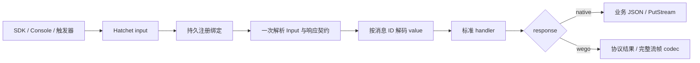

# wego 0.4.0：消息协议 6 与迁移

SDK `0.4.0`，消息与流日志协议 `6`。只改动 wego，依赖官方 Hatchet v0.110.5。任务目标和 protobuf 类型来自 workflow version 的持久绑定；每条输入不再携带 method、scope、format、serializer 或 protobuf 类型。

## Input 与调用契约

无 `_wego` 时，整个 JSON 是业务输入。下面的 value/routing 都是业务字段，不拆包：

```json
{"message":"hello","value":7,"routing":{"business":"field"}}
```

Console 为 CEL 提供独立 routing 时使用显式 Input：

```json
{
  "_wego":{"version":6},
  "value":{"message":"hello"},
  "routing":{"group":"group-a"}
}
```

缺省 response 为 native。wego SDK 提交时自动设置 `response:"wego"`：

```json
{
  "_wego":{"version":6,"response":"wego"},
  "value":{"message":"hello"},
  "routing":{"group":"group-a"}
}
```

有 codec 时，仅 value 是变换结果；外层保留可读调度字段：

```json
{
  "_wego":{
    "version":6,
    "response":"wego",
    "encoding":"base64",
    "codec_ids":["gzip.v1","aes256-gcm.v2"]
  },
  "value":"<变换字节的base64>",
  "routing":{"group":"group-a"}
}
```

`_wego` 是最外层保留字段，出现即按协议验证；不合法时失败，不能回退为原生。标记输入必须有 value，null 与缺少值不同；value 内的 `_wego` 仍是业务字段。输入 encoding 与响应 response 分别声明，response 不是调用者认证。

`model.Input{Value, Routing}` 的 JSON 序列化产生显式明文 Input。protobuf 使用 ProtoJSON / UseProtoNames，普通值使用 JSON。MarshalJSON 不选择 Runtime、不执行 codec；提交入口负责执行实例发送链。数组、标量、null 通过带标记的 value 提交，因为 Console REST 要求 input 为对象。

SDK 对无 codec JSON 检查数值；大整数、高精度小数、浮点溢出及下溢会自动使用 base64 字节承载，不增加 codec。routing 始终是可读 JSON 对象，不安全值在 SDK 提交前失败。原生值在到达 Worker 前已经损失的精度无法恢复；protobuf int64 在 Console 使用 ProtoJSON 字符串形式。

可选头仅在实际需要时存在：metadata、trace、deadline、流提交键、内容摘要、流模式、响应 headers/trailers。普通 metadata 是字符串数组，-bin 用 base64，deadline 用 UTC RFC3339Nano。普通 unary／普通任务不生成输入摘要。可忽略的新字段允许在同版本增加，改变解释方式须升级版本。

## codec

继续使用 middleware.Payload；契约为 CodecID、Encode(ctx, bytes)、Decode(ctx, bytes)、DecodeLimit(ctx, bytes, limit)，没有 scope 参数。

```go
gzipCodec, err := payload.NewGzip(payload.WithThreshold(256 << 10))
if err != nil {
    return err
}
runtime.WithMiddleware(
    middleware.WithPayload(objects),
    middleware.WithPayload(gzipCodec),
    middleware.WithPayload(encrypted),
),
runtime.WithEncodingCodecs(
    payload.GzipCodecID,
    payload.AESGCMCodecID,
    payload.S3ObjectCodecID,
),
```

注册表在实例配置冻结。未指定发送链时按注册顺序编码；显式空链仅关闭发送变换。解码先检查全部 ID，然后逆序执行消息声明的步骤。接收顺序和额外组件不改变历史解码，同一 ID 的重复步骤执行多次。未知 ID 在下载、解密或解压前失败。

AES-GCM 用用户显式配置的 32 字节密钥、随机 nonce、nil AAD；示例 CodecID 为 `aes256-gcm.v2`。不提供 v1 解密兼容。gzip 和 S3 ID 不变。加密只保护 value，不认证 routing、metadata 或版本头。重复发布使用冻结字节，不重新生成 nonce 或对象引用。

限制：最多 16 步、头最多 64 KiB；普通业务解码默认 1 MiB、编码请求默认 4 MiB、编解码各 10 秒。流输入、帧、历史及预取继续使用各自预算。base64、解压及下载过程中执行限制，内部预算服从更早的 context deadline。

## Output 与派生路径

| 响应契约 | 行为 |
|---|---|
| native | 直接返回业务 JSON／ProtoJSON，不执行输出 codec |
| wego | `_wego.version=6`、value、可选 encoding/codec_ids/headers/trailers |

SDK 自己提交的运行严格检查 wego 响应，格式错误不回退接受 native。失败通过 Hatchet 失败通道；wego 保留结构化 status/details、不可重试标记及 metadata，native 保持官方错误行为。失败不包装为成功结果。

普通任务、protobuf 任务、durable 使用注册参数解码；业务 protobuf 不会把普通任务变成 RPC。DAG 从初始输入延续响应契约，ParentOutput 按父输出自己的格式还原。Batch 每项记录响应契约，逐项结果及广播按成员编码。等待事件按事件自己的格式解码，不继承等待者模式。Filter 在 handler 前还原，task.Info 不做下载。

Result.Raw 返回存储快照；需 codec 的读取使用带 context 和错误返回的读取方法。没有业务结果和合法 null 分开处理。

## 触发器和流

Console 立即执行、Schedule、Cron 的官方外层请求保持原样，只有 input 按本协议解释。workflowName、additionalMetadata、优先级和触发时间保留 Hatchet 语义。原生 Webhook／事件业务对象按注册类型解码；SDK Events 编码一次供多个方法消费。Filter Scope 仅用于官方过滤范围，与 codec 无关。

注册 schema 根据 encoding 校验 value：client/bidi 的明文表示为数组，base64 表示为字符串；二者都要求非空提交键。生成桩在同一次绑定查询中核对请求和响应类型，恢复则核对运行实际使用的版本、方向、模式及两端类型。

每个启用 RPC 默认注册 FullMethodName 事件，自定义 key 合并、namespace 处理后稳定去重；禁用方法和纯网络入口不注册事件。

所有流只提交一个任务。server stream 的 value 是单请求，client/bidi 是数组；SDK Send 保存快照，CloseSend 幂等提交，Worker Recv 输入耗尽返回 EOF。

所有流必须有提交键；Console 例子：

```json
{
  "_wego":{"version":6,"idempotency_key":"operation-001"},
  "value":[{"message":"first"},{"message":"second"}],
  "routing":{"group":"group-a"}
}
```

SDK 自动生成键，或使用 WithStreamIdempotencyKey。官方 CEL 读取 `_wego.idempotency_key` 并加 namespace／方法前缀，TTL 默认 24 小时；缺键或空键失败，不用输入 hash 替代业务键。同一次 SDK 事件的不同流接收方法拥有不同幂等身份。

| 调用模式 | server/bidi 输出 | 恢复 |
|---|---|---|
| native | 官方 PutStream，业务 ProtoJSON，无 codec；最终结果仅 sent_messages | 无持久回放，checkpoint 不支持，重试可能重复 chunk |
| wego Reliable | CLAIM/HEADERS/DATA/结束帧整体 codec 后持久发布 | 客户端 token、Worker checkpoint、代次过滤与结果完整性校验 |
| wego Realtime | 完整 wego 帧 codec 后 PutStream | 无持久回放 |

原生调用不因 Worker 配置 Reliable 而进入 Durable Streams。SDK 附着已有运行时核验实际运行所用的版本绑定、响应模式、流模式、规范业务值与 routing；native 同键运行不能被当作 wego 流恢复。对象键顺序及 1／1.0 不改变内容摘要，方法和 namespace 另外绑定执行身份。



## 升级与验证

1. 排空协议 5 任务及旧流，停用仍发送旧 input 的触发器。
2. 协调客户端、Worker 和 SDK 事件生产端升级；普通 CEL 继续读取 input.routing，Filter 读取 payload.routing。
3. 自定义 Payload 删除 scope 参数；AES 示例升级 v2，历史密钥和对象保留由业务管理。
4. 更新 Cron、Schedule、Webhook 及 Console 的 input；保留 workflow 名称与默认事件规则。
5. 验证业务结果后恢复生产。旧定义、运行历史和对象不自动删除，不读取旧协议为新协议。

本机验收使用官方镜像、PostgreSQL MQ、MinIO；按唯一 namespace 清理本轮定义和触发器，历史保留并记录。源码、依赖和 API 边界、单元、race、vet、生成一致性、中文注释、fuzz 与真实引擎均需通过；本轮结果单独记录，历史报告不能替代当前门禁。
