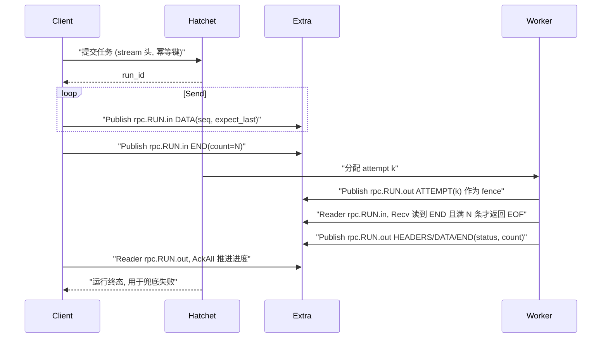

# wego 接入 hatchet-extra：RPC 流重构实现计划

> 状态：待评估、待实现。目标版本 wego `0.5.0`，消息协议 `7`。
> 本文自成一体：先说明背景、需求和已核实的事实，再给出设计、接口草案、删除清单、实施顺序和验收标准。实现者必须先读懂第三节的事实依据再动手，设计中的每个机制都是为了应对其中的某一条。

## 一、背景

### 1. 现状

wego 把标准 gRPC 服务的每个 RPC 映射成一个 Hatchet standalone 任务。`client.Conn` 实现 `grpc.ClientConnInterface`，`server.Server` 实现 `grpc.ServiceRegistrar`。unary 走 Hatchet 的任务输入和输出；三种流目前基于 Hatchet Durable Streams 实现，核心代码如下：

- [internal/stream](../internal/stream)：CLAIM 竞争、epoch 有效日志解释器（`log.go`）、producer、历史、JOIN 屏障。
- [internal/rpc](../internal/rpc) 下的 `stream_*.go`：客户端在 `CloseSend` 时把整批输入作为任务输入一次提交；Worker 的输出写入持久 topic `rpc.<taskID>`。
- [internal/backend/streams.go](../internal/backend/streams.go)、`gated_execution.go`：Durable Streams 发布订阅和 CLAIM 门禁。
- [internal/backend/worker_event_*.go](../internal/backend)：基于 Durable Streams 的 Worker 定向和广播通知。

### 2. 现有实现的问题

- client stream 和 bidi 只能"收齐整批输入再提交"，不支持实时输入，也不支持交互式双向通信。
- server stream 依赖 CLAIM 和整条日志扫描来确定有效前缀，效率很低。
- 没有消费确认（ACK）机制，消费进度只能由业务自己保存凭证。
- 需要租户开启 Durable Streams entitlement，只注册 unary 的 Worker 也受这个限制。

### 3. hatchet-extra

根仓库新增了 hatchet-extra 服务：

- 服务入口：[cmd/hatchet-extra/main.go](../../../cmd/hatchet-extra/main.go)
- 服务实现：[internal/services/extra](../../../internal/services/extra)
- 协议：[proto/v1/extra.proto](../../../internal/services/extra/proto/v1/extra.proto)
- 生成的 Go 包：`github.com/hatchet-dev/hatchet/internal/services/extra/proto/v1`（包名 `extrav1`）

服务提供以下能力：

- 底层：进程内嵌的 NATS JetStream，使用 Hatchet token 做租户鉴权，`Scope.namespace` 是租户内的逻辑分区。
- StreamService：stream 的创建、更新、查询、删除，以及按序号或按 subject 取最后一条消息的 `GetMessage`。
- PublisherService：`Publish` 和 `PublishAsync`，支持 msg-id 去重、期望序号、TTL。
- ConsumerService：具名 durable pull consumer、`Fetch`（长轮询）、`Ack`（ACK/NAK/IN_PROGRESS/TERM）。
- KeyValueService：bucket 管理、Put/Create/Update（CAS）/Get/Delete、History、Watch。

调用时在 gRPC metadata 里带 `authorization: Bearer <Hatchet 租户 token>`。

## 二、需求

1. **client stream**：发起任务拿到 `run_id`，之后每次 `Send` 发布到这个 `run_id` 对应的 subject；Worker 运行时订阅读取；客户端的 `Recv` 订阅本运行的输出。
2. **server stream**：与第 1 条相同，只是请求随任务输入提交，输出走同样的通道。
3. **bidi**：在第 1、2 条的基础上自然支持实时交互。
4. **可靠性**：消费方按发送顺序拿到全部消息，不漏、不重；`CloseSend` 和 Worker 结束时，读端能证明自己读完了。
5. **恢复与回放**：client 和 Worker 任一方中断后都能恢复，并支持从指定位置回放。
6. **新增公开 API**：`conn.Stream()` 和 `conn.KV()`，作为 extra 能力的薄封装。
7. **删除**：基于 Hatchet Durable Streams 的全部实现，不保留兼容层，不受旧设计约束。
8. **模块结构**：保留 wego 自己的 `go.mod`，开发阶段通过 `go.work` 使用本地根模块。

## 三、已核实的事实（设计依据）

以下每条都已对照源码确认，设计中的机制都与之对应。

| 编号 | 事实 | 出处 | 对设计的影响 |
|---|---|---|---|
| F1 | extra 的 `PublishAsync` 为每条请求起一个 goroutine 调用 `Publish`，存储顺序与提交顺序无关 | [publisher.go](../../../internal/services/extra/publisher.go) `PublishAsync`，约 300 行 | 不能用 PublishAsync 承载有序流；写端必须串行 |
| F2 | 只有串行调用 unary `Publish` 时，存储顺序才等于调用顺序 | 同上 | 每个 subject 只允许一个写者、一次只有一个发布在途 |
| F3 | pull consumer 首次投递按存储顺序；NAK、AckWait 到期、Fetch 流中途断开后，未 ACK 的消息会在之后重投，读端会看到空洞或乱序 | JetStream 语义 | 读端必须以自己的帧序号为准，发现空洞要主动修复 |
| F4 | nats-server v2.15.1 先检查 expected-last-subject-seq，再做 msg-id 去重 | `nats-server/v2@v2.15.1/server/stream.go`：6775 行附近做期望序号检查，7019 行附近做 msg-id 去重 | 带期望序号的重试即使上次已成功，也会得到 `WrongLastSequence`，不会返回 duplicate；必须读回最后一条消息确认是否是自己写的 |
| F5 | extra 把 `WrongLastSequence` 映射为 gRPC `FailedPrecondition`，并在 details 中附带 `NatsError` | [publisher.go](../../../internal/services/extra/publisher.go) `Publish` | 写端按这个错误码识别 CAS 冲突 |
| F6 | extra 只支持具名 durable pull consumer，不支持 ordered/push consumer；名称为 1–64 字节，只能用字母、数字、`_`、`-` | [consumers.go](../../../internal/services/extra/consumers.go)、[address.go](../../../internal/services/extra/address.go) | 有序读取要在 SDK 内自己实现；consumer 名称要控制长度 |
| F7 | consumer 的投递策略和起始序号创建后不可修改 | JetStream 语义 | 修复空洞的方式是"删除后按新起始序号重建" |
| F8 | extra 默认单条消息不超过 1 MiB、每次 Fetch 最多 64 条或 4 MiB；unary 和 streaming RPC 各最多 128 个并发；普通 Fetch 最多等待 30 秒 | [README.md](../../../internal/services/extra/README.md) 配置预算一节 | 帧批次要受大小限制；每个活跃读者都占一个长连接 RPC 名额 |
| F9 | namespace 为空，或不超过 64 字节且只含 ASCII 字母、数字、`_`、`-` | [address.go](../../../internal/services/extra/address.go) | wego 的 namespace 要按这个规则校验 |
| F10 | 业务 headers 不能以 `Nats-` 开头，整个 header 不超过 64 KiB | [publisher.go](../../../internal/services/extra/publisher.go) `preparePublish` | wego 的控制头统一使用 `Wego-` 前缀 |
| F11 | `WorkerCancelNotice` 只用于 CLAIM 换代后通知旧 writer 退出 | [stream_observe.go](../internal/rpc/stream_observe.go) 约 191 行 | 新设计用 fence 取代，可以删除 |
| F12 | 业务侧的 Worker 通知（`SendEvent`/`BroadcastEvent`/`WithWorkerEventHandler`）只在 [examples/scenarios/minio_codec.go](../examples/scenarios/minio_codec.go) 中用作探针 | 全仓搜索 | 可以整体删除 |
| F13 | Go 的 `internal` 规则按导入路径判断；wego 模块路径是 `github.com/hatchet-dev/hatchet/sdks/wego`，可以导入 `github.com/hatchet-dev/hatchet/internal/...`；[internal/backend](../internal/backend) 已经这样做了 | [internal/backend/backend.go](../internal/backend/backend.go) | 可以直接导入 extra 的生成包，开发阶段由 go.work 解析到本地根模块 |

实现者在动手前，应写一个小测试分别验证 F3、F4，把结论固定为回归测试（见第九节）。

## 四、总体设计



职责划分：

- **Hatchet**：调度、slot、重试、超时、取消、运行终态。任务输入只包含请求头信息和 server stream 的单个请求，不包含流数据。
- **extra**：两个方向的流数据、消费进度。
- **wego**：帧协议、有序写、有序读、fence、恢复、完整性判定。

### 1. 资源命名

| 资源 | 名称 | 说明 |
|---|---|---|
| Stream | `wego_rpc` | 每个 namespace 一个，subjects 为 `rpc.>`，文件存储；`MaxAge` 默认 24h，`Duplicates` 默认 2m，可通过 `runtime.WithStreamRetention` 配置。Conn 或 Server 首次需要时调用 `CreateOrUpdateStream` 幂等创建 |
| 输入 subject | `rpc.<run_id>.in` | client 写，Worker 读 |
| 输出 subject | `rpc.<run_id>.out` | Worker 写，client 读 |
| Worker 输入 consumer | `i-<run_id>-<attempt>` | 每个 attempt 一个，避免新旧 attempt 抢同一个 consumer 的消息 |
| Client 输出 consumer | `o-<run_id>-<8 位随机 hex>`，或业务通过 `client.WithStreamConsumer(name)` 指定 | 业务指定的名称要校验长度（F6） |

`run_id` 使用 Hatchet workflow run 的 external ID（UUID，36 字节），以上名称都不超过 64 字节。`wego_` 前缀保留给 SDK 内部使用，`conn.Stream()` 和 `conn.KV()` 拒绝业务使用这个前缀。

### 2. 帧协议

一条 NATS 消息是一个**帧批次**，包含一个或多个连续序号的帧。

NATS headers 存放明文控制字段，读端不解码消息体就能校验顺序：

| Header | 含义 |
|---|---|
| `Wego-Version` | 固定为 `7` |
| `Wego-Kind` | `DATA`、`HEADERS`、`ATTEMPT`、`END`；一个批次中的所有帧类型相同，`END` 和 `ATTEMPT` 单独成批 |
| `Wego-First` / `Wego-Last` | 本批次的帧序号区间。序号在每个 subject 内从 1 开始连续递增，所有类型的帧共用同一序列 |
| `Wego-Attempt` | 写者的 attempt（client 写 `.in` 时为 0） |
| `Wego-Writer` | 本次写者的随机 nonce，用于在发生 F4 的情况时确认最后一条消息是否是自己写的 |
| `Wego-InputMark` | 仅 Worker 的 `.out` 帧使用：产生这些输出时已消费到的输入帧序号（Resume 模式依赖它） |
| `Wego-Count` | 仅 `END` 使用：本 subject 中 END 之前的 DATA 总条数 |
| `Wego-Codec` | 消息体实际执行的 CodecID 列表，逗号分隔；为空表示未变换 |

消息体使用新的 protobuf `FrameBatch`，放在 [internal/wire](../internal/wire) 中，替换 `stream.proto` 里的 `LogFrame`：

```proto
message FrameBatch {
  repeated bytes payloads = 1;          // DATA：每条业务消息的 ProtoJSON
  map<string, Values> headers = 2;      // HEADERS：响应 headers
  map<string, Values> trailers = 3;     // END：响应 trailers
  google.rpc.Status status = 4;         // END：最终状态（含 details、不可重试标记）
}
```

整个消息体经过现有的 `wire.FrameCodec`（gzip、zstd、AES-GCM、S3），实际执行的 CodecID 写入 `Wego-Codec`。控制头不加密，也不在 AES 认证范围内，这一点要写进文档。

### 3. 写端 `streamlog.Writer`

新建包 [internal/streamlog](../internal/streamlog)，client 写 `.in` 和 Worker 写 `.out` 共用这个实现。

```go
// Writer 是一个 subject 的唯一有效写者；顺序由单 goroutine 串行发布和期望序号保证。
type Writer struct { /* ... */ }

func OpenWriter(ctx context.Context, x Transport, opts WriterOptions) (*Writer, Resume, error)
func (w *Writer) Send(ctx context.Context, kind Kind, payload []byte) error // 入队；队列满时阻塞
func (w *Writer) Flush(ctx context.Context) error                            // 等待已入队的帧全部落盘
func (w *Writer) Close(ctx context.Context, end End) error                    // Flush 后发布 END
```

**打开**：调用 `GetMessage(last_subject=<subject>)` 读回最后一条消息，得到 `lastStreamSeq` 和 `lastFrameSeq`。subject 为空时两者都是 0。最后一条已经是 `END` 时返回 `ErrStreamClosed`。返回的 `Resume` 包含最后一条消息的帧头，供 Worker 做 fence 判断和恢复。

**发布循环**：

1. 一个后台 goroutine 从有界队列（`MaxQueueMessages`、`MaxQueueBytes`）中取出当前所有待发帧，合成一个批次。批次大小不超过 `MaxBatchBytes`，且不超过 extra 的 `MaxMessageBytes`（F8）。
2. 调用 unary `Publish`，设置：
   - `message_id = <run_id>:<dir>:<first>-<last>`
   - `expected_last_subject_sequence = lastStreamSeq`
3. 成功后用 PubAck 中的 sequence 更新 `lastStreamSeq`。
4. 一次只有一个发布在途，保证存储顺序等于帧序号（F1、F2）。

**错误处理**：

- `Unavailable`、`DeadlineExceeded` 或连接中断（结果不明确）：用相同的 msg-id 和期望序号重试，带退避，总时长受 `PublishTimeout` 限制。
- `FailedPrecondition`，即 `WrongLastSequence`（F4、F5）：读回最后一条消息。
  - 如果 `Wego-Writer` 等于自己且 `Wego-Last` 等于本批次的 last，说明上一次已经写成功，按成功处理。
  - 否则说明有别的写者，返回 `ErrFenced`。写端终止，之后所有 `Send` 都返回该错误。
- 其他错误：直接失败。

**结束**：`Close` 先 `Flush`，再发布单帧批次 `END`，带上 `Wego-Count` 和 status、trailers。由于期望序号的约束，END 一定是该 subject 的最后一条有效消息。

### 4. 读端 `streamlog.Reader`

```go
// Reader 按帧序号严格有序地交付；重复的帧丢弃，空洞通过重建 consumer 修复。
type Reader struct { /* ... */ }

func OpenReader(ctx context.Context, x Transport, opts ReaderOptions) (*Reader, error)
func (r *Reader) Next(ctx context.Context) (Frame, error) // 读到 END 且计数完整时返回 io.EOF
func (r *Reader) Commit(ctx context.Context, frameSeq uint64) error // AckAll 到这一帧所在的批次
func (r *Reader) Position() Position                       // {FrameSeq, StreamSeq}
func (r *Reader) Close(ctx context.Context, deleteConsumer bool) error
```

**consumer 配置**：

- `FilterSubject` 为单个 subject。
- `AckPolicy=All`，`MaxAckPending` 等于预取窗口，`AckWait` 设得足够长（默认 5 分钟）。
- `InactiveThreshold` 默认 10 分钟，用于自动回收。
- 起始位置：
  - 新建时，`DeliverByStartSequence` 等于调用方给出的 stream seq + 1；没有给出时用 `DeliverAll`。
  - 已存在时直接复用，从服务端的 ack floor 继续。

**拉取**：循环调用 `Fetch`，每次在 `max_messages` 和 `max_bytes` 的预算内拉取，长轮询等待时间为 `FetchWait`（默认 25 秒，小于 extra 的 30 秒上限）。拉取到的批次放入有界预取队列。

**有序交付**（核心，对应 F3）：维护 `expected = 最后交付的帧序号 + 1`。

- 批次的 `Wego-Last` 小于 `expected`：重复投递，丢弃，但仍要 ACK 以推进 ack floor。
- 批次的 `Wego-First` 等于 `expected`：按序交付。
- 批次的 `Wego-First` 大于 `expected`：出现空洞。删除 consumer，以"最后一个已交付批次的 stream seq + 1"为起始序号重建，然后继续拉取，不等 AckWait。
- 首个批次的 `Wego-First` 不是 1（并且不是从中途恢复）：说明数据已超出保留期被清除，返回 `DataLoss`。

**完整性**：读到 `END` 后，检查已交付的 DATA 条数等于 `Wego-Count`，并且帧序号连续，满足才返回 `io.EOF`；否则返回 `DataLoss`。

**提交**：只对已交付的连续前缀提交（AckAll，F7）。服务端的 ack floor 就是可恢复的消费位置。

### 5. RPC 流程

#### client stream / bidi（客户端）

1. 调用 `NewStream` 时立即提交任务。任务输入是协议 7 的 envelope：`_wego.stream = {shape, idempotency_key}`，不带 `value`。
2. 拿到 `run_id` 后，`OpenWriter(.in)` 和 `OpenReader(.out)`。
3. `Send` 把 ProtoJSON 快照交给 Writer。`MaxSend` 按单条消息检查。队列满时阻塞，形成背压。
4. `CloseSend` 调用 `Writer.Close(END)`；如果有发布失败，返回错误。
5. `Recv` 调用 `Reader.Next`。交付给业务后再 `Commit`；为减少往返，可以按批次或条数节流提交。

任务在 Hatchet 排队期间，client 照常写入 `.in`，两边互不依赖。

#### server stream（客户端）

请求放在任务输入的 `value` 中，与 unary 相同；客户端只打开 `.out` 的 Reader。

#### 内联输入

Console、事件、Cron 触发的 client stream 和 bidi，任务输入的 `value` 是数组，Worker 直接读取，不打开 `.in`。

#### 幂等提交

流的幂等键沿用现有的 Hatchet 幂等 CEL（[stream_worker.go](../internal/rpc/stream_worker.go) 中的 `policy.Idempotency` 配置）。发生冲突时，从错误中取出 `ExistingRunID`，转为附着已有运行：

- Writer 从最后一条消息续写；如果输入已经 END，则不能再 Send。
- Reader 从头读取，或从业务提供的位置读取。

#### 结束判定（客户端）

- Reader 返回 END：按 END 中的 status 返回 `io.EOF` 或错误，并把 trailers 写给调用方。
- 后台同时调用 `ref.Wait` 观察 Hatchet 运行终态：
  - 运行失败或被取消，而 Reader 还没读到 END：返回运行错误，并关闭 Reader。
  - 运行成功，但过了 `CompletionTimeout`（默认 30 秒）仍没有 END：返回 `DataLoss`。

#### 取消（客户端）

- 同步调用的 ctx 被取消：取消本次自己拥有的运行，沿用 [unary.go](../internal/rpc/unary.go) 中 `unaryWaitError` 的规则。
- `ResumeStream` 得到的流只停止观察，不取消运行。

### 6. Worker 执行

`StreamDefinition`（[stream_worker.go](../internal/rpc/stream_worker.go)）改写为以下步骤：

1. **解析输入**：解析 envelope，恢复 deadline、metadata 和 trace，这部分沿用现有的 `wire.Incoming`。
2. **打开输出 Writer 并做 fence**：用 `OpenWriter(.out)` 读回最后一条消息。
   - 最后一条是 `END`：直接按 END 的内容返回任务结果，不执行 handler。
   - 最后一条的 `Wego-Attempt` 大于当前 attempt（`TaskInfo.RetryCount`）：说明自己已经过时，以不可重试错误退出。
   - 否则发布 `ATTEMPT(k)` 帧。只要它写入成功，旧 attempt 之后的任何发布都会因期望序号不符而得到 `ErrFenced`，旧 attempt 立即取消自己的 handler 并退出。
3. **打开输入**：内联输入直接读取；否则打开 `.in` 的 Reader，consumer 名称为 `i-<run_id>-<attempt>`，起始位置由恢复模式决定。
4. **调用 handler**：沿用现有的服务端 stream 拦截器链。
5. **handler 返回后**：
   - 成功：先 `Flush`，再发布 `END(OK, trailers, count)`，然后返回 Hatchet 输出 `{"sent_messages": N}`。
   - 失败且还会重试（错误可重试，且 `RetryCount` 小于配置的重试次数）：只 `Flush` 已产生的输出，不发 END，把错误返回给 Hatchet。
   - 失败且不再重试（不可重试错误，或重试次数已用完）：发布 `END(status)` 后返回错误。
6. **输入空闲超时**：`StreamOptions.InputIdleTimeout`（默认 5 分钟）内没有新的输入帧，也没有 END，`Recv` 返回 `DeadlineExceeded`，并作为不可重试错误结束。

#### 恢复模式

通过 `runtime.WithStreamRecovery(fullMethod, runtime.StreamReplay | runtime.StreamResume)` 配置，默认 `StreamReplay`。

| 模式 | 输入起点 | 输出处理 | 适用场景 |
|---|---|---|---|
| Replay | 每个 attempt 从第 1 帧开始读 | SDK 记录已落盘的最大 DATA 序号 L；handler 重新产生的前 L 条输出直接丢弃，不重复发布，从第 L+1 条开始真正写入 | 确定性处理：相同输入总是产生相同输出；handler 不需要任何恢复代码 |
| Resume | 从最后一条输出的 `Wego-InputMark` + 1 开始读 | 从 L+1 开始写 | 非确定性处理；业务通过 `task.StreamResume(ctx)` 拿到 `{LastOutputSeq, LastOutput, InputMark}` 自行恢复状态 |

Resume 模式的说明：

- 输入在被 handler 通过 `Recv` 取走时计入 InputMark。
- "处理完一条输入、但还没产生输出就崩溃"的窗口内，这条输入会被重新交付，属于至少一次语义，需要在文档中说明。
- server stream 没有输入流，两种模式的区别只在于输出是否自动去重。

### 7. Client 恢复与回放

```go
// StreamPosition 读取一个流调用当前可持久化的位置。
func StreamPosition(stream grpc.ClientStream) (model.StreamPosition, error)

type StreamPosition struct {
	RunID     string
	Method    string
	InputSeq  uint64 // 已落盘的最后一个输入帧
	OutputSeq uint64 // 已交付给业务的最后一个输出帧
	Consumer  string // 输出 consumer 名称
}

func (c *Conn) ResumeStream(ctx context.Context, pos model.StreamPosition, opts ...grpc.CallOption) (grpc.ClientStream, error)
func WithReplayFrom(frameSeq uint64) RunOption   // 新建 consumer，从指定帧回放
func WithStreamConsumer(name string) RunOption   // 指定 consumer 名称，进度保存在服务端
```

- `ResumeStream` 先通过 Hatchet 核验运行确实属于该 namespace 和方法（复用 `ValidateRunTarget`），然后：
  - 复用 `pos.Consumer` 所指的 consumer，从服务端 ack floor 继续读；如果 consumer 已被回收，就从 `OutputSeq + 1` 重建。
  - 如果输入还没有 END，允许继续 `Send`：Writer 从最后一条消息续写。
- 删除旧的 `StreamResumeToken` 及其所有相关逻辑。

### 8. 资源清理

- consumer 依赖 `InactiveThreshold` 自动回收；正常结束时，Reader 主动删除自己创建的 consumer（业务指定名称的除外）。
- subject 中的数据由 stream 的 `MaxAge` 统一过期，运行结束时不主动清除，以便之后还能回放。

### 9. 容量与限制

- 每个活跃流的每个读者占用一个 extra 长连接 RPC 名额（F8）。新增 `runtime.WithExtraLimits(runtime.ExtraLimits{MaxReaders})` 限制本实例的并发读者数，超过时 `NewStream` 返回 `ResourceExhausted`。文档中注明需要按并发流数量调大 extra 的 `--max-concurrent-rpcs`。
- 单个批次不超过 extra 的 `MaxMessageBytes`。单条业务消息编码后仍超限时，依赖 S3 codec；没有配置 S3 则报 `ResourceExhausted`。
- 每条流的吞吐受串行发布往返延迟的限制，靠合批弥补。性能基线需要记录"单条消息"和"合批"两种情况。

## 五、Worker 通知：删除

依据见 F11 和 F12。删除后，只注册 unary 的 Worker 既不需要 Durable Streams，也不需要 extra。

删除范围：

- `model.WorkerEvent`、[model/worker_event.go](../model/worker_event.go)
- [runtime/worker_events.go](../runtime/worker_events.go)（`WithWorkerEventOptions`、`WithWorkerEventHandler`）
- `Workers().SendEvent`、`BroadcastEvent`（[internal/features/management.go](../internal/features/management.go)）
- `ports.WorkerSendEvent`、`ports.WorkerCancelNotice`（[internal/ports/worker_events.go](../internal/ports/worker_events.go)）
- [internal/backend/worker_event_publish.go](../internal/backend/worker_event_publish.go)、[worker_event_subscribe.go](../internal/backend/worker_event_subscribe.go) 及相关测试
- [internal/stream/barrier.go](../internal/stream/barrier.go)、[internal/spec/worker_events.go](../internal/spec/worker_events.go)
- 示例 [minio_codec.go](../examples/scenarios/minio_codec.go) 中的探针，改为使用 `conn.KV()` 验证 codec
- [examples/acceptance.json](../examples/acceptance.json) 和 [scripts/manifest/main.go](../scripts/manifest/main.go) 中的相关条目

## 六、模块与连接

- 保留 [go.mod](../go.mod) 和 [go.work](../go.work)，后者已经 `use ../..`。
- wego 直接导入 `github.com/hatchet-dev/hatchet/internal/services/extra/proto/v1`（依据 F13）。
- 单元测试导入 `github.com/hatchet-dev/hatchet/internal/services/extra`，启动进程内服务；`go.mod` 补上 `nats-server/v2`、`nats.go` 等依赖。
- `GOWORK=off` 的发行验证暂时无法通过，要等发布包含 extra 的 hatchet 版本后再升级 require。[scripts/acceptance.py](../scripts/acceptance.py) 中依赖 `GOWORK=off` 的门禁改为开发阶段跳过，并输出明确的原因。
- 新增配置：

```go
runtime.WithExtra(runtime.ExtraConfig{
	Address:   "127.0.0.1:7080", // hatchet-extra gRPC 地址
	TLSConfig: nil,              // nil 表示明文；与 WithTLSConfig 的规则一致
})
runtime.WithStreamRetention(24*time.Hour, 2*time.Minute) // wego_rpc 的 MaxAge 与 Duplicates
runtime.WithStreamRecovery(pb.Greeter_ChatHellos_FullMethodName, runtime.StreamResume)
runtime.WithExtraLimits(runtime.ExtraLimits{MaxReaders: 256})
```

- token 复用 `runtime.WithToken`，namespace 复用 `runtime.WithNamespace`，并按 F9 校验。
- 新建包 [internal/extra](../internal/extra)：
  - 持有 gRPC 连接，通过拦截器注入 `authorization` metadata；
  - 为每次调用设置预算；
  - 把 extra 的错误映射为 gRPC status，保留 `NatsError` details；
  - 提供 `streamlog.Transport` 接口的实现（Publish、GetLastBySubject、CreateConsumer、DeleteConsumer、Fetch、Ack）；
  - 由 [internal/engine](../internal/engine) 装配，关闭时释放连接。
- 只有注册或调用流式 RPC、或者使用 `Stream()`/`KV()` 时才要求配置 extra。纯网络模式、只用 unary 的 Conn 和 Worker 都不需要。

## 七、公开 API：conn.Stream() 和 conn.KV()

放在 [internal/features](../internal/features)，与现有的 `Crons()`、`Events()` 风格一致；类型定义在 [model](../model)，不暴露 NATS 或 extra 的 proto 类型。

```go
s := conn.Stream()
s.CreateOrUpdate(ctx, model.StreamConfig{Name, Subjects, MaxAge, MaxBytes, MaxMsgs, MaxMsgSize, Duplicates, Storage, AllowMsgTTL})
s.Get(ctx, name) / s.List(ctx) / s.Delete(ctx, name)
s.Publish(ctx, model.Message{Subject, Data, Headers}, model.PublishOptions{MsgID, ExpectedLastSubjectSeq, TTL}) (model.PubAck, error)
s.GetMessage(ctx, stream, model.MessageSelector{Sequence | LastBySubject})
s.CreateOrUpdateConsumer(ctx, stream, model.ConsumerConfig{Name, FilterSubjects, DeliverPolicy, StartSeq, AckPolicy, AckWait, MaxDeliver, MaxAckPending, InactiveThreshold})
s.GetConsumer / s.DeleteConsumer
s.Fetch(ctx, stream, consumer, model.FetchOptions{MaxMessages, MaxBytes, Wait, NoWait}) ([]*model.Delivery, error)
s.Consume(ctx, stream, consumer, func(context.Context, *model.Delivery) error, opts) error // handler 返回 nil 则 Ack，否则 Nak
// model.Delivery: Message、Metadata{StreamSeq, ConsumerSeq, NumDelivered, NumPending, Timestamp}、
//                 Ack(ctx)、AckSync(ctx)、Nak(ctx, delay)、InProgress(ctx)、Term(ctx, reason)

kv := conn.KV()
kv.CreateOrUpdateBucket(ctx, model.BucketConfig{Name, History, TTL, MaxValueSize, MaxBytes, LimitMarkerTTL})
kv.GetBucket / kv.DeleteBucket
kv.Get(ctx, bucket, key, model.WithRevision(rev)) (model.KVEntry, error)
kv.Put(ctx, bucket, key, value) (uint64, error)
kv.Create(ctx, bucket, key, value, model.WithKeyTTL(d)) (uint64, error)   // 已存在返回 AlreadyExists
kv.Update(ctx, bucket, key, value, expectedRev) (uint64, error)            // 版本冲突返回 Aborted
kv.Delete(ctx, bucket, key, model.WithExpectedRevision(rev))
kv.History(ctx, bucket, key) iter.Seq2[model.KVEntry, error]
kv.Watch(ctx, bucket, keys, model.WatchOptions{IncludeHistory, IgnoreDeletes, UpdatesOnly, ResumeFromRevision}) iter.Seq2[model.KVWatchEvent, error]
```

载荷与 codec：

- Stream 消息的 `Data` 经过实例发送链编码，实际执行的 CodecID 写入 `Wego-Codec` 头；读取时按这个头逆序解码。
- KV 值使用自描述前缀：一个魔数字节，后跟 CodecID 列表，再跟数据。没有配置 codec 时直接保存原始字节，不加前缀；读取时以魔数区分。
- 两者都遵守 `PayloadLimits` 中的大小和超时预算。

## 八、删除清单

- [internal/stream](../internal/stream) 整个目录。
- [internal/backend/streams.go](../internal/backend/streams.go)、`gated_execution.go`，以及对应的 `*_test.go` 和 `*_e2e_test.go`。
- 端口与执行门禁：`ports.DurableStreams`、`DurableMessage`、`DurableEntry`、`DurableSubscription`、`Definition.BeforeStart`、`StartInfo`、`Admission`。
- [internal/rpc](../internal/rpc) 下的 `stream_checkpoint.go`、`stream_observe.go`、`stream_submission.go`、`stream_notifications.go` 删除；`stream_client.go`、`stream_worker.go`、`stream_receive.go`、`stream_server.go`、`stream.go` 按新设计重写。
- [internal/callctx/checkpoint.go](../internal/callctx/checkpoint.go)、[task/checkpoint.go](../task/checkpoint.go)、[client/stream.go](../client/stream.go) 中的 `StreamResumeToken`。
- [internal/wire/stream.proto](../internal/wire/stream.proto) 中的 `LogFrame` 及对应的生成代码，以及 `log_codec.go` 和 `native_stream.go` 中的旧逻辑。
- 运行时配置：`runtime.Realtime` / `Reliable`、`WithStreamMode`、`WithStreamIdempotencyTTL`（并入新的 StreamOptions）；`StreamOptions` 中的 `ClaimTimeout`、`PublishTimeout`（改为由 Writer 使用）、`RecoveryTimeout`、`MaxCheckpointMessages`、`MaxCheckpointBytes`、`MaxReplayFrames`、`MaxReplayBytes`。
- 原生 PutStream 路径，以及 `task.StreamEvent`（原生 Console 调用 server stream 时，输出同样写入 `.out`）。
- [scripts/enable-durable-streams.py](../scripts/enable-durable-streams.py) 及其测试。
- 相关的 fuzz 目标、[tests/e2e](../tests/e2e) 中的 `stream_*`、`rpc_realtime_events_test.go`、`worker_events_test.go`，以及 [docs/design](design) 中协议 6 流章节的现行描述（历史报告保留不改）。

## 九、实施顺序

每一步结束时，都要保证 `go build ./...`、`go vet ./...` 和已有的单元测试通过（工作区模式）。

1. **接线**（extra-conn）：`runtime.WithExtra` 和 `internal/extra`；go.mod 补依赖；写一个进程内 extra 的测试夹具 `internal/extra/extratest`。先写两个事实验证测试：
   - `TestFactExpectedSeqBeforeDedup`：固定 F4 的行为。
   - `TestFactRedeliveryAfterBrokenFetch`：固定 F3 的行为。
2. **写端**（streamlog-writer）：实现 Writer 及其单元测试。
3. **读端**（streamlog-reader）：实现 Reader 及其单元测试。
4. **Worker 侧**（rpc-worker）：重写 `StreamDefinition`；实现 fence、两种恢复模式和 END 规则。
5. **客户端侧**（rpc-client）：重写客户端流；实现 `StreamPosition`、`ResumeStream`、`WithReplayFrom`、`WithStreamConsumer`。
6. **删除旧实现**（remove-legacy）：删除 Durable Streams 和 Worker 通知全套；清理配置、示例和 manifest。
7. **公开 API**（public-stream-kv）：`conn.Stream()` 和 `conn.KV()`。
8. **e2e**（tests）：compose 增加 hatchet-extra，重写 e2e 测试和性能基线。
9. **文档**（docs）：协议 7、`v0.5.0.md`、README、`worker.md`、`module.md`、CHANGELOG；`version.go` 改为 `0.5.0`。

## 十、测试与验收

### 1. 单元测试

单元测试使用进程内 extra，外加一层 gRPC 客户端故障注入：可以丢弃响应、在第 N 条后切断 Fetch 流、延迟调用。

| 场景 | 断言 |
|---|---|
| 发布响应丢失（服务端已写成功） | 重试得到 `WrongLastSequence`，读回确认是自己写的后按成功处理；subject 中没有重复帧 |
| 两个 Writer 写同一个 subject | 后来者 fence 成功后，先前的写者得到 `ErrFenced` 并停止 |
| Fetch 流在批次中途断开 | 读端发现空洞后重建 consumer，最终交付序列与发送序列完全一致，不漏不重 |
| 重复投递（AckWait 到期） | 重复帧被丢弃，ack floor 正确推进 |
| 丢失最后一条 DATA 后出现 END | 返回 `DataLoss`，不返回 EOF |
| 数据超出保留期（首帧不是 1） | 返回 `DataLoss` |
| client stream / bidi 实时交互 | bidi 每 Send 一条，在 CloseSend 之前就能 Recv 到对应的回复 |
| Worker 在第 k 条输出后崩溃（Replay 模式） | 重试后输出序列完整、无重复，handler 不需要恢复代码 |
| Worker 崩溃（Resume 模式） | `task.StreamResume` 返回正确的 `LastOutputSeq` 和 `InputMark`，输入从 InputMark+1 开始 |
| 旧 attempt 在新 attempt fence 之后仍在运行 | 旧 attempt 的发布被拒绝，handler 的 ctx 被取消 |
| `.out` 已有 END 时重试 | 不执行 handler，直接返回已有结果 |
| handler 出错且还会重试 | 不发 END，client 继续等待；最终成功时 client 只看到成功结果 |
| 输入空闲超时 | Worker 返回 DeadlineExceeded，不重试；client 收到对应错误 |
| client 崩溃后恢复 | 用 `StreamPosition` 恢复后续读和续写都正确，`WithReplayFrom` 能从指定帧回放 |
| 内联输入（事件触发） | Worker 不创建 `.in` 的 consumer，结果正确 |
| 只注册 unary 的 Worker | 不配置 extra 也能正常启动和执行 |
| Stream 和 KV 公开 API | CRUD、CAS 冲突错误码、Watch 的 initialized 标记、codec 往返、拒绝 `wego_` 前缀 |

### 2. e2e

- [tests/compose.yml](../tests/compose.yml) 增加 hatchet-extra 服务：挂载 Hatchet 公钥，设置 `EXTRA_ACK_KEY`，设置 `SERVER_SECURITY_CHECK_ENABLED=false`。
- 使用真实的 Hatchet 和 extra 跑通三种流、Worker 进程被杀后的恢复、client 进程重启后的恢复，以及 100 路并发的性能基线（记录 P50、P95、P99 和吞吐）。

### 3. 完成标准

- 第二节的需求逐条有测试覆盖。
- 第八节的删除清单全部完成，`rg "DurableStreams|PutStream|CLAIM|WorkerEvent" sdks/wego --type go` 没有结果。
- 公开 API 不暴露 NATS 或 extra 的类型（现有的 API 门禁通过）。
- 工作区模式下 `go test ./...`、`go test -race ./...`、`go vet ./...` 全部通过。

## 十一、待评估的风险

- **吞吐**：串行发布限制了单条流的吞吐。需要用性能基线确认合批后是否满足要求；不满足时，可以考虑让 extra 开放原子批量发布（`allow_atomic_publish`）。
- **长连接名额**：每个活跃读者占用一个 extra 长连接 RPC，大规模并发时需要扩容 extra，或者在 extra 中增加多路复用的 Fetch 接口。
- **单节点**：extra 目前是单节点，没有容灾；流数据的可用性取决于它。
- **控制头不受加密保护**：`Wego-*` 控制头不在 AES 认证范围内，能篡改 extra 存储的人可以伪造顺序信息。如果需要防篡改，可以把控制字段复制进加密的消息体中再校验一次。
- **Resume 模式的语义**：Resume 是"至少一次"语义，崩溃窗口内的输入可能被重复处理，需要在文档中明确说明。
