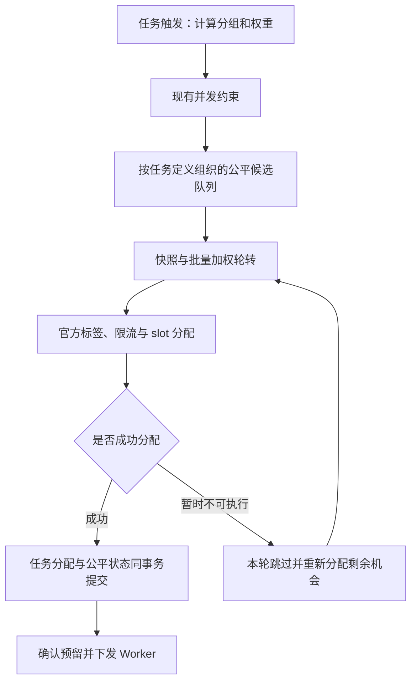

# Hatchet 分组加权公平调度：设计评估与实施计划

> 状态：设计文档已落盘，服务端功能尚未实现。本文中的 API、算法和验收条件均为拟实现方案，不代表当前官方 Hatchet 或 wego 已提供这些能力。
>
> 核验日期：2026-10-13。官方源码基线：`hatchet-dev/hatchet` main，`4a02006a40cff43180ca2f56c59113a1b12eca76`。实施前重新核验官方 main 的相关变更。
>
> 上游英文 issue 草稿：[weighted-fair-scheduling-issue.en.md](weighted-fair-scheduling-issue.en.md)。草稿需要用户审阅、编辑后再提交；当前未提交 issue 或 PR。

## 1. 目标、确定的语义与边界

在 Hatchet 服务端增加分组加权调度策略，第一版用于**同一个任务定义内的不同分组**。多个 Worker 副本共同提供执行容量，不按 Worker 分别计算分组份额。

已确认的规则：

- 根据实际可用 Worker slots 分配任务，不另设固定共享容量。
- 权重通过 CEL 表达式计算。
- 权重分配的是**后续调度机会**，不重新均分已经运行的任务。
- 从上次调度位置的下一个组继续；新活跃组加入队尾。
- 组内沿用 Hatchet 优先级：高优先级先执行，同优先级按入队顺序处理。
- 需求不足、暂时不可执行的组让出本轮未使用份额，其他组可以借用。
- 不取消或抢占已经执行的任务。

例如，当前有 100 个可用标准 slots，每项任务消耗 1 slot：

| 分组情况 | 分配结果 |
|---|---|
| 只有 A 有任务 | A 最多获得 100 |
| A、B 等权，均有足够任务 | A 50，B 50 |
| A、B 权重 1:3 | A 25，B 75 |
| A、B 等权，A 只有 10 项 | A 10，B 90 |
| 100 个等权组，均有任务 | 每组 1 |
| A 已运行 90 项，B 新加入，释放 10 slots | A、B 各获得约 5 个新机会 |

这些例子假设没有额外资源约束，整数分配从没有未完成额度的逻辑轮开始。中断轮次继续使用剩余额度；不能为了让单个快照的数字整齐而重置公平状态。

公平的统计单位是**成功调度的任务次数**。同一任务定义的 slot 请求通常相同；slot cost 和不同类型资源仍按 Hatchet 的原有规则预留。该策略不承诺 CPU 时间、完成吞吐量或正在执行的任务数严格按权重分布。

公平范围使用任务定义的持久身份，不能使用可能被其他定义复用的 action ID。相同定义的多 Worker 副本共享公平状态；不同定义版本沿用官方的版本隔离。第一版不做跨 workflow 的租户级共享公平调度。

## 2. 策略接口与调度算法

### 2.1 接口

新增策略名称：

```text
GROUP_WEIGHTED_ROUND_ROBIN
```

名称体现实际行为，避免将其描述为运行中容量的自动均衡。

在现有 Concurrency 配置中增加：

```go
// 以下为拟新增接口示意，当前 SDK 不支持这两个新标识。
Concurrency{
    Expression:       "input.routing.group",
    LimitStrategy:    GroupWeightedRoundRobin,
    WeightExpression: "input.routing.weight",
}
```

示例中的 `routing` 是 wego 输入结构；官方实现接受一般 CEL 输入表达式，不依赖 wego 封包，也不要求普通 Hatchet 用户提供 `routing`。

配置语义：

- `Expression` 继续使用官方分组表达式规则。
- `WeightExpression` 省略时权重为 1；表达式结果必须是 `1–10000` 的整数。
- 同组权重由最新创建任务的计算值更新；重试和旧任务重新入队不能回退权重。
- 权重更新在下一逻辑轮生效，当前轮使用冻结的权重。
- 新策略未指定 `MaxRuns` 时不设置每组硬上限，不能套用现有默认值 1。
- 显式 `MaxRuns` 仍表示每组硬上限；它可能限制该组借用容量。
- `MaxRunsExpression` 沿用官方动态上限语义。权重决定机会分配，上限决定是否允许继续调度，两者独立。
- 旧策略的默认值和执行语义保持不变。

同一个任务最多配置一个加权公平策略，且位于并发策略链末端。前面的普通并发约束继续决定任务是否具备进入公平调度的资格。

第一版支持普通和 durable 任务，以及 DAG 中的单个任务节点。Batch 使用独立的聚合与分配路径，暂不接受新策略；注册时明确报错，不静默采用其他行为。

### 2.2 加权轮转与跨轮状态

采用整数配额的加权轮转，不使用浮点累计，也不把每次调度唤醒视为全新轮次。

每个逻辑轮：

1. 冻结参与组的顺序和权重。
2. 每组获得与权重相同的基础调度额度。
3. 从持久游标继续，按组内优先级选取任务。
4. 成功调度消耗额度；额度耗尽的组等待下一逻辑轮。
5. 因 slots 用尽而中断时，保存未完成额度和游标。
6. 逻辑轮结束后补充下一轮额度，继续使用可用容量。

这样即使每次只释放 1 slot，权重 1:3 也不会退化为长期 1:1。

新组追加到待参与队列尾部，进入下一逻辑轮；不能延长已经冻结的轮次，避免持续出现的新组使旧组迟迟得不到下一轮机会。

只剩运行中任务、没有可调度积压的组，不参与份额分配。重新出现可调度积压时加入队尾，不积攒空闲期间的额度。

### 2.3 根据快照批量计算

常见情况下，不逐 slot 扫描全部分组：

- 使用本次可执行任务容量、各组需求、权重和剩余额度。
- 对可以完整执行的逻辑轮，直接计算每组累计配额，批量跳过这些轮次。
- 对需求不足的组，扣除实际需求后移出本次计算。
- 只对最后不完整的轮次处理游标和整数余量。
- 批量算法必须与简单逐步轮转的参考实现得到相同结果。

例如权重 1:3、100 个可用 slots，可直接计算 25 个完整轮次，得到 25/75；不需要实际遍历 100 次分组选择。

### 2.4 复用已有资源分配能力

继续使用官方的：

- Worker action 匹配。
- 标签与硬亲和、Sticky。
- slot cost、多类型 slot 请求。
- 限流预留及其确认、撤销。
- Worker slot 预留、提交、ACK/NACK。

新策略决定候选任务和配额，现有分配器决定任务能否落到具体 Worker。

某组暂时无法分配时，本轮不继续反复尝试同一个失败候选，把未使用机会交给其他组；后续由容量变化、限流恢复或任务入队事件唤醒。

组内优先级作用于可执行候选。无法满足硬约束的高优先级任务，不应永久阻挡同组其他可执行任务，沿用官方当前的候选尝试行为。

复杂亲和和多资源约束下，不承诺一次计数就找到数学上的最优匹配，也不重新实现全局回溯匹配。实际成功预留结果是本轮最终分配依据。

## 3. 服务端实现与故障恢复

### 3.1 实现位置

当前并发策略只对单个分组独立决策；Worker 分配队列之后还会按优先级排序。仅在并发层新增一个函数，无法保持最终执行的组间公平。[官方并发实现](https://github.com/hatchet-dev/hatchet/blob/4a02006a40cff43180ca2f56c59113a1b12eca76/pkg/scheduling/v1/concurrency/strategy.go)、[官方 Worker 分配路径](https://github.com/hatchet-dev/hatchet/blob/4a02006a40cff43180ca2f56c59113a1b12eca76/pkg/scheduling/v1/scheduler.go)

实现分为三个职责：

| 部分 | 职责 |
|---|---|
| 注册和触发 | 校验配置，计算并持久化分组、权重及上限 |
| 公平候选选择 | 维护组顺序、额度和需求，生成有序候选 |
| 官方分配器 | 检查资源约束，预留 slots，提交任务分配 |

不新增外部调度服务、不引入新的 MQ。



图中重新分配必须受本轮候选集合和进展检查约束；不能在没有可执行任务时持续空转。

### 3.2 队列与快照

- 新策略使用任务定义对应的公平队列域，复用官方队列租约和通知机制。
- 持久化队列项关联公平策略和分组；为按组取任务建立索引。
- 维护分组积压摘要，按分组分页读取候选，不能从全局前 100 条任务反推活跃组。
- 每组候选按官方优先级和稳定入队顺序读取。
- 调度快照不包括之后到达的新任务；这些任务参与后续快照。
- payload 保留在原任务存储中，调度器只缓存有界候选及必要元数据。

Worker 容量以现有 Scheduler run loop 的状态为准，不能使用监控接口的周期快照代替实际预留状态。

### 3.3 分配顺序和提交

- 公平候选不能再被下游按全局优先级重新排序。
- 在同一公平域内串行生成和确认分配批次；不同域继续并行。
- 数据库 I/O 放在 run loop 之外，不能持有全局调度执行权等待数据库。
- 只根据实际成功分配更新配额；失败预留走官方回收路径。
- 分批大小不改变公平语义，不能每读取一页就重新初始化权重或游标。
- 一个公平域中的分组享有本策略的公平保证；其他任务共享 Worker 时，不额外承诺跨任务公平。

### 3.4 持久状态与一致性

持久化以下状态：

- 活跃／待加入组顺序。
- 当前游标和逻辑轮身份。
- 每组当前轮剩余额度。
- 生效权重及待生效更新。
- 状态版本和分配批次身份。

公平状态与对应任务分配在同一数据库事务中提交：

- 回滚时同时撤销公平状态和资源预留。
- 提交结果不明确时，先核实批次是否提交，不能直接重新分配。
- 使用租约所有权和状态版本检查，拒绝失去所有权的调度器提交。
- Scheduler 接管时从持久状态恢复，不能按 map 顺序重建轮转顺序。
- 未完成分配批次未核实前，不推进下一批次。

任务重试重新进入原分组，遵守官方重试与入队语义；实际再次分配才消耗新的调度机会。取消、超时和重复通知必须幂等处理。

### 3.5 性能约束

- 公平分配器是无 I/O 的独立算法，方便测试和基准验证。
- 不建立按权重重复展开的组数组。
- 不扫描全部任务 payload，不为每个组创建长期 goroutine。
- 常见路径按活跃组和实际分配数量计算，批量跳过完整轮次。
- 对暂时不可执行的候选有界尝试；本轮无进展时停止，等待现有通知或轮询兜底。
- 指标记录分配量、等待时间、借用容量、不可执行原因及分配耗时；不默认将任意分组 key 用作 Prometheus label，避免高基数。

## 4. 实施阶段与验收

### 阶段安排

| 阶段 | 工作与退出条件 | 当前状态 |
|---|---|---|
| 提案准备 | 中文方案落盘、英文 issue 草稿完成，等待人工审阅和上游反馈 | 文档已完成；未提交上游 |
| P0：语义和参考模型 | 固定上述规则；完成简单参考算法、批量算法和性质测试 | 待实施 |
| P1：配置与持久状态 | 协议、注册校验、CEL、迁移、索引及状态事务闭环 | 待实施 |
| P2：调度链路 | 公平取候选、官方资源匹配、实际分配和失败回收贯通 | 待实施 |
| P3：故障与性能 | 多 Scheduler、租约切换、回滚、提交不明确和大量分组验证 | 待实施 |
| P4：SDK 与交付 | 官方 Go SDK 示例、文档、完整回归、上游 PR 材料 | 待实施 |

P0 的公平性和可恢复性未通过前，不进入引擎接入。讨论期间的小规模算例不等同于 P0 完成或真实引擎验收。

### 必须通过的测试

| 分类 | 必测场景 |
|---|---|
| 基础分配 | 单组用满、等权 50/50、权重 1:3、100 个等权组 |
| 需求不足 | 空组、部分需求、剩余容量重新分配、多组依次耗尽 |
| 小批次 | 每次释放 1 slot，长期保持权重比例；分页不改变结果 |
| 组生命周期 | 新组队尾、当前轮冻结、组退出再加入、连续出现新组 |
| 优先级 | 组内高优先级优先、同级 FIFO、跨组优先级不覆盖公平 |
| 权重与上限 | 默认权重、非法 CEL、权重更新、旧任务重投、可选硬上限 |
| 官方资源约束 | 多 Worker、required affinity、Sticky、slot cost、多类型 slots、限流 |
| 真实执行 | 在 Worker 开始执行处断言分配结果，不能只测候选列表 |
| 故障恢复 | 事务回滚、提交响应丢失、租约切换、旧调度器晚提交 |
| 生命周期 | Worker 退出、扩缩容、排空、取消、超时、重试及 durable 恢复 |
| 回归 | 所有已有并发策略、普通队列与批处理路径 |

算法测试使用随机输入，对照简单参考实现，检查容量约束、任务不重复、权重分配和游标连续性。并发路径运行 race。

性能基准覆盖 10、100、1 万个活跃组，大积压、小批次和大量不可执行候选。报告吞吐量、调度延迟、分配次数、分配字节及数据库查询量；比较改动前后的普通路径，避免新策略拖慢未启用功能的任务。

真实引擎验证使用 PostgreSQL MQ 和隔离的测试环境。新增策略必须使用本次源码构建的镜像，官方发行镜像只用于原行为对照。CI 启动点显式设置 `SERVER_SECURITY_CHECK_ENABLED=false`。

## 5. 文档、升级与上游 PR

### 文档与代码边界

官方核验基线：

```text
hatchet-dev/hatchet main
4a02006a40cff43180ca2f56c59113a1b12eca76
```

执行实现时创建独立工作区，基于届时官方 main 重新核验差异。当前 wego 工作区已有大量未提交修改，不将它们带入官方 PR。

上游功能不依赖 wego。第一版提供官方 Go SDK 配置与完整示例，协议生成模型同步更新；wego 适配作为独立后续变更。

本文保存于 wego 文档目录，仅表示上游功能提案。wego 的文档版本更新不代表新调度策略已经可用。

### 升级约束

- 使用追加式协议字段与枚举，旧策略序列化及定义 checksum 不变。
- 新策略仅在数据库迁移及所有调度节点升级完成后启用。
- 功能开关默认关闭；未启用时注册新策略明确失败。
- 旧调度节点不得接管新策略队列。
- 回滚前停止新策略提交并排空其队列，不能将新策略静默映射为已有策略。
- SDK 版本和 changelog 按仓库要求更新；官方 Go SDK 按 tag 发布，不新增版本文件。

### 上游流程

官方要求 PR 关联已经标记 `accepted`、并分配给贡献者的 issue；AI 辅助必须披露。AI 生成的 issue 内容还要求人工审阅和编辑。[贡献要求](https://github.com/hatchet-dev/hatchet/blob/4a02006a40cff43180ca2f56c59113a1b12eca76/CONTRIBUTING.md)、[AI 使用政策](https://github.com/hatchet-dev/hatchet/blob/4a02006a40cff43180ca2f56c59113a1b12eca76/AI_POLICY.md)

交付顺序：

1. 完成中文设计文档和精简的英文 issue 草稿。
2. 由用户审阅、编辑提案，再按授权提交 issue。
3. 根据维护者反馈固定公共接口，完成实现和全部验证。
4. 满足 accepted／assignment 条件后提交官方 PR。

建议 PR 标题：

```text
feat(engine): add demand-aware weighted group round-robin scheduling
```

PR 必须附带语义示例、故障恢复说明、实际 Worker 执行断言及性能对比，明确公平范围和非抢占边界。

**完成标准：同一任务定义内按权重分配实际可用容量，组内保持官方优先级，新组排在队尾，低需求组让出份额，小批次和重启不破坏公平状态；官方已有资源约束正常工作，回归与故障测试通过，并形成可提交上游的独立改动。**
